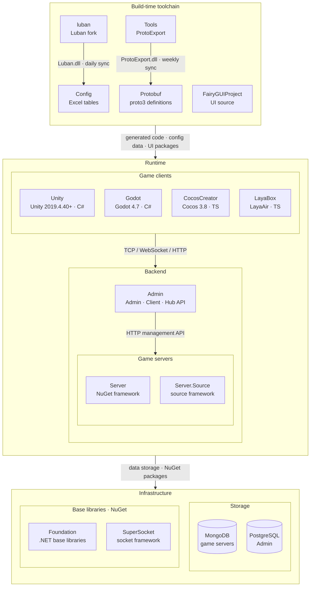

<div align="center">


# Luban

[](LICENSE.md)
[](https://github.com/GameFrameX/luban/releases)
[](https://gameframex.doc.alianblank.com)

[](https://discord.gg/VDWUjWMDw9)
[](https://github.com/GameFrameX/gameframex)
[](https://www.bilibili.com/video/BV1yrpeepEn7)
[](https://gitee.com/GameFrameX/gameframex)

インディゲーム開発者向けオールインワンソリューション · インディ開発者の夢を支援

<br />

[ドキュメント](https://gameframex.doc.alianblank.com) · [クイックスタート](#クイックスタート) · QQグループ: 467608841 / 233840761

<br />

[English](README.md) \| [简体中文](README.zh-CN.md) \| [繁體中文](README.zh-TW.md) \| **日本語** \| [한국어](README.ko.md)

</div>

## プロジェクト概要

luban は強力で使いやすく、エレガントかつ安定したゲーム設定（コンフィグ）ソリューションです。小規模から超大型のゲームプロジェクトにおける、シンプルから複雑までのゲーム設定ワークフローのニーズを満たすことを設計目標としています。

luban は多様なファイル形式に対応し、主流の言語をサポートし、複数のエクスポート形式を生成でき、豊富なデータ検証機能を備え、優れたクロスプラットフォーム能力を持ち、しかも生成が非常に高速です。

luban は明快でエレガントな生成パイプライン設計を持ち、優れたモジュール化とプラグイン化に対応しているため、開発者は二次開発を容易に行えます。開発者は luban を自分の設定形式に簡単に適合させ、プロジェクトの要求を満たす強力な設定ツールをカスタマイズできます。

luban はゲーム設定開発ワークフローを標準化し、プランナーとプログラマーの作業効率を大幅に向上させます。

**5.0.0** 以降、Luban は AI Agent / IDE に向けて **AI Native** 能力を提供します。公式 Skills、機械可読な schema とエラー、`Luban.Agent` CLI、および MCP Server により、テーブル追加、schema 参照、検証と生成を Agent に安定して任せることができます。

### GameFrameX ブランチについて

本リポジトリは [focus-creative-games/luban](https://github.com/focus-creative-games/luban) の GameFrameX ブランチであり、公式 **v5.1.0** をマージ済みです。公式 v4 / v5 の基盤リファクタリングと AI 能力を取り込むと同時に、以下の GameFrameX 独自の機能と修正を保持しています。ブランチ関連の問題は [GameFrameX/luban Issues](https://github.com/GameFrameX/luban/issues) までお送りください。

#### 公式バージョンとの機能差異

| 機能 | 説明 |
|:-----|:-----|
| split コード生成ターゲット | 既存ターゲット名に `-split` を付加し、定義とランタイムコードを別ファイルに出力。詳細は[説明](#split-コード生成ターゲットの追加)を参照 |
| `cs-litjson` / `cs-litjson-split` | GameFrameX LitJson ベースの C# コード生成ターゲット。詳細は[説明](#cs-litjson--cs-litjson-split-コード生成ターゲットの追加)を参照 |
| C# ランタイム形態 | `cs-bin`、`cs-dotnet-bin`、`cs-dotnet-json`、`cs-simple-json`、`cs-litjson` およびその `-split` 変種は GameFrameX ランタイム形態を生成：テーブルクラスは `BaseDataTable<T>` を継承し、`Tables.Init(ConfigComponent)` 後に `LoadAsync` で非同期ロード。`cs-code`、`cs-editor-json`、`cs-newtonsoft-json` はこの形態を使用しない |
| ファイル名による自動テーブル取り込み | `tableImporter.name=gameframex`。ファイル名とディレクトリからテーブル名・グループ・名前空間を推論。詳細は[説明](#自動テーブル取り込みのファイル名拡張認識の追加)を参照 |
| 取り込み除外ディレクトリ | `--excludePath`。詳細は[説明](#テーブル取り込み除外ディレクトリパラメータ---excludepath-の追加)を参照 |
| ローカライズフォルダ | `l10n.provider=gameframex`。`l10n.textFile.path` が複数フォルダに対応。詳細は[説明](#ローカライズのフォルダ設定対応の追加)を参照 |
| text インラインローカライズ | `l10n.inline.*`。詳細は[説明](#text-インラインローカライズ対応)を参照 |
| enum 自動収集 | `auto_extend`。詳細は[説明](#enum自動収集autoextend能力の追加)を参照 |
| 同名 `--xargs` の複数値 | 同名パラメータを複数回指定可能。リストセマンティクスのパラメータは出現順にすべての値を取得 |
| ターゲットフレームワーク | `net10.0` に統一（公式は `net8.0`） |
| `Luban.GUI` | Avalonia ベースのデスクトップ取り込みツール（`src/Luban.GUI`） |
| Docker イメージ | [Docker](#docker) を参照 |

#### v5.1.0 マージ後の独自修正の状態

| 修正 | 元コミット | マージ後の状態 |
|:-----|:-------|:-----------|
| l10n：`TranslateText` が継承関係に応じて `virtual` / `override` を生成 | `24774645` | 保持 |
| l10n：インラインローカライズ xlsx の差分マージ、変更なし時は再書き込みしない、ソース言語 value 変更時に同期 | `a8fd260c`、`b2a3e7b7`、`421349aa` | 保持 |
| cs-dotnet-json：テーブルクラスが `_loadFunc` を自己保持し、基底クラスの JSON コンストラクタをチェーンしない | `e1f39884` | 保持 |
| cs-dotnet-json：非 null ref フィールドの値取得を `TryGet` に変更 | `27b318b8` | 保持 |
| cs-dotnet-bin：list / one テーブルの `LoadAsync` に `override` を追加、map テーブルは再ロード前に `LongDataMaps` をクリア | `ff138c33` | 保持 |
| cs-bin-split：`bean.def` テンプレートから余分な `using SimpleJSON` を削除 | `95b08b0b` | 保持 |
| table テンプレートの list / one モードで重複するフィールドとコンストラクタを生成 | `92aea61d` | 保持 |
| バイト読み取りに `ReadExactly` を使用し短読みを回避 | `1e2333f3` | 保持 |
| 整数フィールドで `0x` 16 進リテラルをサポート | `dd520088` | 公式実装に置き換え（公式 `42e5a380`、`LoadDataUtil.TryParseExcelIntFromNumberOrConstAlias`） |
| `map<int, _>` の key で `0x` 16 進リテラルをサポート | `a93ab40f` | 保持（公式は map key のパースパスを未カバー） |
| Bean のフルネームとフィールド名が同名の場合のコンパイルエラー、`[*items,,,*items]` 複数行マーカー、末列の結合セル越界 | `368c5344`、`d6c7a87c`、`534dd6c0` | 公式に同等修正あり、公式実装を優先 |

### 機能概要

- 豊富なソースデータ形式。excel 系（csv、tsv、xls、xlsx、xlsm）、json、xml、yaml、lua などに対応
- 豊富なエクスポート形式。binary、json、bson、xml、lua、yaml などの形式のデータを生成可能
- 拡張された excel 形式。シンプルなリスト、サブ構造、構造リスト、さらに任意に複雑で深いネスト構造を簡潔に設定可能
- 完備された型システム。一般的な正規の行リストだけでなく、**OOP 型継承をサポート**するため、ビヘイビアツリー、スキル、ストーリー、ダンジョンのような複雑な GamePlay データを柔軟かつエレガントに表現可能
- 多言語対応。c#、java、go、cpp、lua、python、javascript、typescript、rust、php、erlang、godot などの言語コードの生成を内蔵サポート。さらに protobuf などのメッセージスキーム経由で他言語にも対応
- 主流のメッセージスキームをサポート。protobuf（schema + binary + json）、flatbuffers（schema + json）、msgpack（binary）
- 強力なデータ検証能力。ref 参照チェック、path リソースパス、range 範囲チェックなど
- 充実のローカライズ対応
- **AI Native（5.0.0+）**。公式 Agent Skills、`-c schema-json`、`--errorFormat json`、`Luban.Agent`（検証 / テーブル参照 / describe）、`Luban.Mcp`（IDE ツール呼び出し）
- すべての主流ゲームエンジンとプラットフォームに対応。Unity、Unreal、Cocos2x、Godot、WeChat ミニゲームなど
- 優れたクロスプラットフォーム能力。Win、Linux、Mac プラットフォームで良好に動作
- すべての主流ホットアップデート方式をサポート。hybridclr、ilruntime、{x,t,s}lua、puerts など
- 生成コードはリフレクション API を一切呼び出さず、[Obfuz](https://github.com/focus-creative-games/obfuz)、Obfuscator、Confuser、.Net Refactor などの一般的なコード難読化・強化ツールと互換
- 明快でエレガントな生成パイプラインにより、luban ベースの二次開発が容易で、プロジェクトのスタイルに合った設定ツールをカスタマイズ可能

## クイックスタート

### インストール

ソースからビルド（本ブランチの AI ツールは 3 つの独立した出力ディレクトリに発行されます）：

```bash
dotnet build src/Luban/Luban.csproj -c Release -o <out>/Luban
dotnet build src/Luban.Agent/Luban.Agent.csproj -c Release -o <out>/Luban.Agent
dotnet build src/Luban.Mcp/Luban.Mcp.csproj -c Release -o <out>/Luban.Mcp
```

または Docker イメージを使用（メインプログラム `Luban` のみ含み、`Luban.Agent` と `Luban.Mcp` は含まない）。バージョン tag は Git tag と一致し、`v` プレフィックスなしの SemVer 形式（例：`3.13.1`）。利用可能なバージョンは [Releases](https://github.com/GameFrameX/luban/releases) を参照。

| Registry | Image |
|:---------|:------|
| Docker Hub | `docker.io/gameframex/gameframex-luban:<version>` |
| GitHub Container Registry | `ghcr.io/gameframex/gameframex-luban:<version>` |
| Aliyun Container Registry | `<ALIYUN_REGISTRY_URL>/<ALIYUN_NAMESPACE>/gameframex-luban:<version>` |

```bash
docker run --rm docker.io/gameframex/gameframex-luban:<version> --help
```

現在のプロジェクトディレクトリで Luban を実行する場合、作業ディレクトリをマウントできます：

```bash
docker run --rm -v "$PWD:/work" -w /work docker.io/gameframex/gameframex-luban:<version> --help
```

発行イメージは厳密なバージョン tag のみ提供し、`latest`、`5`、`5.1` などの浮動 tag は提供しません。

### テストの実行

メインリポジトリには xUnit 統合テストが同梱されています（外部の `luban_examples` に依存しません）：

```bash
dotnet test src/Luban.Tests/Luban.Tests.csproj
```

- フィクスチャと期待出力：`tests/fixtures/`、`tests/golden/`
- golden の刷新（エクスポート動作変更後）：`pwsh tests/scripts/update-goldens.ps1` または `bash tests/scripts/update-goldens.sh`
- テスト実行時に環境変数 `LUBAN_UPDATE_GOLDEN=1` を設定すると golden をその場で更新することも可能

## 使用例

### AI サポート

公式 v5 の AI Native 能力は v5.1.0 とともに本ブランチへマージ済みです：

| 能力 | エントリ | 用途 |
|:-----|:-----|:-----|
| Agent Skills | [`ai/skills/`](./ai/skills) | テーブル追加、テーブル記入、schema 設計、バリデータ、生成トラブルシュート、ランタイムロードの 6 スキル |
| schema-json | `-c schema-json` | 機械可読な `schema.json` を出力 |
| JSON 診断 | `--errorFormat json` | 失敗時に stderr へ構造化 JSON 診断を出力 |
| Luban.Agent | [`src/Luban.Agent`](./src/Luban.Agent/README.md) | `capabilities` / `list-tables` / `describe` / `schema` / `validate`、stdout に単一の JSON 結果を出力 |
| Luban.Mcp | [`src/Luban.Mcp`](./src/Luban.Mcp/README.md) | stdio MCP Server。IDE / Agent からの呼び出し用 |

#### MCP Server の起動

MCP クライアント設定に登録します（`mcpServers` 形式、`<out>` は実際の出力ディレクトリに置き換え）：

```json
{
  "mcpServers": {
    "luban": {
      "command": "dotnet",
      "args": ["<out>/Luban.Mcp/Luban.Mcp.dll"],
      "env": {
        "LUBAN_AGENT_DLL": "<out>/Luban.Agent/Luban.Agent.dll",
        "LUBAN_DLL": "<out>/Luban/Luban.dll",
        "LUBAN_DOC": "<luban-doc>/docs"
      }
    }
  }
}
```

- `LUBAN_AGENT_DLL` と `LUBAN_DLL` の設定は必須です。未設定の場合、Luban.Mcp はソースツリー内の `bin/Release|Debug/net8.0` のみをフォールバック探索しますが、本ブランチのターゲットフレームワークは `net10.0` のため、フォールバックパスはヒットしません。
- `LUBAN_DOC` はオプションで、luban-doc リポジトリの `docs` ディレクトリを指定し、`search_docs` で使用されます。
- 公開されるツール：`list_tables` / `get_schema` / `describe` / `validate` / `generate` / `search_docs`。パラメータは [`src/Luban.Mcp/README.md`](./src/Luban.Mcp/README.md) を参照。

#### スキルの使用

`ai/skills/` 配下のスキルディレクトリを Agent のスキルディレクトリ（`.cursor/skills/`、`~/.claude/skills/` など）へコピーします。詳細は [`ai/README.md`](./ai/README.md) を参照。

#### コマンドライン

```bash
# 機械可読 schema をエクスポート（schema.json は outputCodeDir へ出力）
dotnet <out>/Luban/Luban.dll --conf luban.conf -t all -c schema-json -d json -x outputCodeDir=<codeDir> -x outputDataDir=<dataDir>

# 失敗時に診断を JSON で出力（stderr へ書き込み）
dotnet <out>/Luban/Luban.dll --conf luban.conf -t all -d json --errorFormat json -x outputDataDir=<dataDir>

# 検証のみ、ファイル出力なし
dotnet <out>/Luban.Agent/Luban.Agent.dll validate --conf luban.conf -t all
```

ドキュメント：[AI サポート概要](https://www.datable.cn/docs/ai/overview) · [Skills](https://www.datable.cn/docs/ai/skills) · [Agent CLI](https://www.datable.cn/docs/ai/agent-cli) · [MCP](https://www.datable.cn/docs/ai/mcp) · [schema-json](https://www.datable.cn/docs/ai/schema-json)

### 変更と追加

#### split コード生成ターゲットの追加

既存のコード生成ターゲットを壊さずに、元のターゲット名に `-split` サフィックスを付加した一連のコード生成ターゲットを新設します。

split ターゲットは生成コードをより細かい粒度のファイルへ分割します。定義情報は閲覧・レビュー・AI コンテキスト向けの Def ファイルへ出力し、パース・ロード・ランタイムコードは Impl またはランタイムファイルに保持します。これにより、単一の設定型だけに注目する場合は、対応する Def ファイルを読めばよく、完全な全量 schema ファイルを読む必要がありません。

##### 使用シーン

- **AI 支援開発**：Def ファイルを AI コンテキストとしてモデルに提供。フィールドと型定義のみを含み、デシリアライズ実装を含まないため、トークン消費が少なく信号対雑音比が高い。
- **コードレビューと日常的な参照**：特定の設定テーブルのフィールド意味を確認したいだけなら、対応する Def ファイルを直接開けばよく、数千行の全量 schema ファイル内を探す必要がない。
- **マージコンフリクトの低減**：schema 調整は Def ファイルに集中し、ランタイムコードの変更と互いに干渉せず、diff がより焦点を絞ったものになる。
- **非侵襲的な共存**：既存の非 split ターゲットの動作は完全に不変で、両方のターゲットをエクスポート target ごとに選択可能。

##### 使用方法

ターゲット命名規則は「元のコード生成ターゲット + `-split`」で、エクスポートコマンドの `--codeTarget` を対応する split ターゲットに置き換えるだけで、その他のパラメータは不変です：

```text
dotnet Luban.dll --target client --dataTarget bin --codeTarget cs-bin-split --xargs outputDataDir=./Output/Data --xargs outputCodeDir=./Output/Code --conf ./luban.conf
```

Go 言語の split ターゲットはモジュール名の追加指定が必要です：

```text
--xargs lubanGoModule=github.com/gameframex/config
```

各言語の split 出力ファイル命名（`Tables` 名前空間の `ItemConfig` テーブルの場合）：

| 言語 | 定義ファイル（Def） | ランタイムファイル（Impl） |
|:-----|:---------------|:------------------|
| C# | `Tables/ItemConfig.Def.cs` | `Tables/ItemConfig.Impl.cs`（マージされた `ItemConfig.cs` は生成されない） |
| Go | `Tables.ItemConfig.def.go` | `Tables.ItemConfig.impl.go` |
| Rust | `cfg/src/Tables.ItemConfig.Def.rs`、`Tables.TbItemConfig.Def.rs`、`Tables.Def.rs` | `cfg/src/tables.rs`、`cfg/src/lib.rs` |
| C++ | `Tables.ItemConfig.Def.h` | `schema.h`、`Tables.ItemConfig.Impl.cpp` |
| Java | `Tables/ItemConfigDef.java`（定義コンパニオンクラス） | `Tables/ItemConfig.java` |
| TypeScript | `Tables.ItemConfig.def.ts`、`Tables.def.ts` | `schema.ts` |
| Lua | `Tables.ItemConfig.def.lua` | ランタイム schema ファイル |
| PHP / GDScript | `Tables.ItemConfig.def.php` / `Tables.ItemConfig.def.gd` | ランタイム schema ファイル |

Def ファイルは定義情報（フィールド、型、定数宣言）のみを含み、デシリアライズ、構築、ロードなどのランタイムコードを含みません。この制約は受け入れスクリプトのアサーションにより保証されます。

サポート済みの split ターゲット：

| 言語 | ターゲット |
|:-----|:-----|
| C# | `cs-simple-json-split`, `cs-litjson-split`, `cs-bin-split`, `cs-dotnet-json-split`, `cs-dotnet-bin-split` |
| Go | `go-json-split`, `go-bin-split` |
| Rust | `rust-json-split`, `rust-bin-split` |
| C++ | `cpp-rawptr-bin-split`, `cpp-sharedptr-bin-split` |
| Java | `java-json-split`, `java-bin-split` |
| TypeScript | `typescript-json-split`, `typescript-bin-split`, `typescript-protobuf-split` |
| Python | `python-json-split` |
| Lua | `lua-bin-split`, `lua-lua-split` |
| PHP | `php-json-split` |
| GDScript | `gdscript-json-split` |

分割規則は言語能力に応じて一貫したセマンティクスを保持します：

- C#、Go、C++ は Def/Impl スタイルのファイルを出力し、定義コンテキストとランタイム実装を区別しやすくする。
- Java は同一の public class のファイル間分割をサポートしないため、ランタイムクラスと `XxxDef` 定義コンパニオンクラスを出力する。
- TypeScript、Python、Lua、PHP、GDScript はランタイム schema ファイルを保持しつつ、各型に対応する `*.def.*` 定義ファイルを追加出力する。

ローカル受け入れスクリプト：

```
BASE=/tmp/luban-split-code-targets-acceptance scripts/accept-split-code-targets.sh
```

#### cs-litjson / cs-litjson-split コード生成ターゲットの追加

`cs-simple-json` / `cs-simple-json-split`（SimpleJSON ベースのコードを出力し続ける）を変更せず保持したまま、`cs-litjson` と `cs-litjson-split` の 2 つの独立した C# コード生成ターゲットを新設します。GameFrameX LitJson パッケージ（名前空間 `GameFrameX.LitJSON.Runtime`、メインクラス `JsonData` / `JsonMapper`）ベースのデシリアライズコードを出力します。後方互換であり、既存の `cs-simple-json` 系ターゲットの動作は不変で、ランタイムで導入済みの JSON ライブラリに応じて対応するターゲットを選択してください。

| ターゲット | 対応する元ターゲット | ランタイム依存 | 出力形式 |
|:-----|:------------|:----------|:---------|
| `cs-litjson` | `cs-simple-json` | `GameFrameX.LitJSON.Runtime` | 単一ファイル、定義とランタイムコードをマージ出力 |
| `cs-litjson-split` | `cs-simple-json-split` | `GameFrameX.LitJSON.Runtime` | split 出力、定義情報は Def ファイル、ランタイムコードは Impl ファイル |

##### 使用シーン

- ランタイム（特に Unity ホットアップデート層）が GameFrameX LitJson を JSON ライブラリとして統一しており、設定ロードをプロジェクトの他の部分と同じ JSON 依存にまとめ、SimpleJSON を同時に導入したくない場合。
- split 粒度（定義 / ランタイム分離）と LitJson デシリアライズが必要な C# プロジェクト。

##### 使用方法

```text
--codeTarget cs-litjson        # 単一ファイル出力、定義とランタイムをマージ
--codeTarget cs-litjson-split  # Def / Impl 分離出力
```

前提：ランタイムプロジェクトに GameFrameX LitJson パッケージ（名前空間 `GameFrameX.LitJSON.Runtime`、メインクラス `JsonData` / `JsonMapper`）が導入済みであること。生成コードはこのパッケージのみに依存し、SimpleJSON には依存しません。`cs-simple-json` 系ターゲットと互いに影響せず、エクスポート target ごとに選択可能です。`cs-litjson-split` は上記 split ターゲット一覧の C# 行に含まれています。

#### ローカライズのフォルダ設定対応の追加

プロジェクトでは、言語テーブルが共同作業時にコンフリクトを起こすことがよくあります。その場合、Sheet の分離ではなく、モジュールごとにテーブルファイル自体を分離する必要があります。そこで、ローカライズフォルダ設定がフォルダ配下のすべてのファイルをローカライズファイルとして認識するようにしました。

##### 設定例

- l10n.provider=`gameframex`

ここは `gameframex` でなければなりません。そうでない場合、ローカライズファイルの認識に失敗します。

- l10n.textFile.path=`./Excels/Tables/Localization/`

この値はフォルダパスでなければなりません。そうでない場合、ローカライズファイルの認識に失敗します。このパラメータは複数フォルダの繰り返し指定に対応します。

エクスポートパラメータの参考：

```
--xargs l10n.provider=gameframex --xargs l10n.textFile.keyFieldName=key  --xargs l10n.textFile.path=./Excels/Tables/Localization/
```

##### 複数フォルダのロード（繰り返しパラメータ対応）

`l10n.textFile.path` は複数フォルダの繰り返し指定に対応し、モジュールごとのローカライズテーブル分割とコンフリクト回避に使用します：

```text
--xargs l10n.provider=gameframex --xargs l10n.textFile.keyFieldName=key
--xargs l10n.textFile.path=./Excels/Tables/LocalizationModuleA/
--xargs l10n.textFile.path=./Excels/Tables/LocalizationModuleB/
```

- 同名の `--xargs` パラメータを複数回指定でき、duplicate エラーは発生しなくなりました。値はコマンドラインの出現順に順次ロードされます。
- リストセマンティクスでないその他のパラメータは最初に出現した値が優先されます。
- 各フォルダはトップレベルのファイルのみをスキャンし、サブディレクトリは再帰しません。サブディレクトリをロードする必要がある場合は別途 1 行設定を追加してください。
- フォルダパスが存在しない場合はエラーログを記録してスキップし、他のフォルダのロードには影響しません。
- 異なるファイルに同一 key が存在する場合、重複エラーログを記録します。

#### text インラインローカライズ対応

通常のスカラー `text` は 1 列または 2 列の記法に対応し、特殊なフィールドマーカーを追加する必要はありません：

```text
フィールド名行：... | name |        | description |        | id
型行：        ... | text |        | text        |        | int
データ行：    ... | key  | 中文値  | desc_key    | 説明値  | 1
```

`text` の次の列のフィールド名と型が両方とも空の場合のみ、その列を value 列として認識します。それ以外の場合、`text` は 1 列のみを占めます。単列 `text` の value は key と等しくなります。1 つのテーブルに複数の `text` フィールドを持てますが、通常のスカラーのみサポートし、`list<text>`、配列、map、複数行 text のインライン value はサポートしません。

明示的に有効化すると、Luban は業務データのロード完了後、業務テーブルの完全名ごとに独立したローカライズ XLSX ファイルを生成します。Provider 未設定の場合はファイル生成のみ行い、業務データ中の key は置き換えません：

```text
--xargs l10n.inline.enabled=true
--xargs l10n.inline.languageFieldName=zh_CN
--xargs l10n.inline.outputPath=Localization/Generated
--xargs l10n.inline.outputFileNameFormat=L-Localization-c-{table}.xlsx
```

`l10n.inline.outputPath` は自動生成されるローカライズ `.xlsx` ファイルのディレクトリを指定し、相対パスと絶対パスに対応します。相対パスは Luban プロセスの現在の作業ディレクトリが基準です。例：

```text
--xargs l10n.inline.outputPath=/path/to/Config/Excels/Local/Generated
```

`l10n.inline.outputFileNameFormat` は自動生成されるローカライズ `.xlsx` のファイル名テンプレートを指定し、デフォルトは `{table}.xlsx` です。テンプレートはプレースホルダに対応しています（いずれもファイル名として安全なサニタイズが行われます）：

- `{table}`：業務テーブルの完全名。
- `{source}`：元 xlsx のファイル名（拡張子を除く）。
- `{sourceDir}`：元 xlsx の所在ディレクトリの最後のセグメント。
- `{rawName}`：元ファイル名を `-`/`_` で分割した第 2 セグメント（GameFrameXTableImporter の rawTableName と一致）。
- `{comment}`：元ファイル名から分割した第 3 セグメント以降を `-` で連結したもの。
- `{sheet}`：元 xlsx 内の sheet 名（同一ファイルの複数 sheet 分割時に区別用）。sheet 概念がない場合は空。

同一テーブルが複数のソースファイルや同一ファイルの複数 sheet（分割テーブル）から構成される場合があります。source 部品ごとにグループ化してファイル名を計算し、テンプレートで区別されていないグループは同じ出力ファイルへ自動マージされます。テンプレートに `{source}`/`{sheet}` などの区別的プレースホルダを含む場合は分割テーブルごとに分割され、`{table}` のみの場合は 1 テーブル 1 ファイルを維持します。source が欠けている場合、`{source}` は `{table}` に退化します。GameFrameX 命名規約（例：`L-Localization-c-{namespace}.{テーブル名}-{中文コメント}.xlsx`）で出力ファイル名を付けたい場合は以下を使用：

```text
--xargs l10n.inline.outputFileNameFormat=L-Localization-c-{sourceDir}.{rawName}-{comment}.xlsx
```

入力 `Tables/D-ItemConfig-道具表-道具.xlsx` → 出力 `L-Localization-c-Tables.ItemConfig-道具表-道具.xlsx`。

##### 再生成時のマージセマンティクス

`l10n.inline.*` が生成した `.xlsx` ファイルは削除や全表上書きを**行わず**、差分マージされます：

- **既存 xlsx に存在する key**：`l10n.inline.languageFieldName` で指定されたソース言語列は業務テーブルが基準となり、value 変化時は同期更新。その他の言語列（翻訳者が記入した翻訳）は不変。
- **業務テーブルで追加された key**：inline で書き込まれたデフォルト value でファイル末尾に追記。
- **業務テーブルで削除された key**：ファイルには保持（削除しない）。
- **ユーザーが手動追加した row**：保持。
- **多言語列**：既存のすべての列を保持。`l10n.inline.languageFieldName` で指定された列が既存ファイルに欠けている場合は metadata でその列を拡張。
- **行順序**：既存行は元の順序を厳格に保持。新規追記行は末尾に追加。
- **ファイル再書き込み**：新 key、新言語列、ソース言語 value の変化があった場合のみ xlsx を再書き込みし、内容に変化がない場合はファイルを触らない。再書き込み時、セルテキストと `##` コメント行は保持されるが、スタイル情報（色、列幅、コメント等）は保持されない。

簡単に言うと：**追記のみ、削除なし、並べ替えなし。ソース言語列は業務テーブルに追従し、その他の言語列は上書きしない**。初回 inline 実行後、生成ディレクトリを翻訳の入口として扱うべきです。以降の実行では新しく出現した key の追記とソース言語 value の同期のみが行われ、翻訳済みの他言語の内容は常に保持されます。

生成ファイルは既存の Luban テーブル形式を使用し、元のメタデータヘッダーレイアウトを維持します。データ行は B 列から填充（A 列は空）、ヘッダー言語列は `key | zh_CN`、ファイル拡張子は `.xlsx` です。外部の手動ローカライズテーブルは inline value より優先されます。inline key が異なるテーブルに出現する場合、value は一致している必要があり、正当な空 value は保持されます。

#### 自動テーブル取り込みのファイル名拡張認識の追加

ファイル名規約により設定テーブルを自動登録します。テーブル構造は xlsx 内に直接記述し、ファイル名にソートプレフィックス、テーブル名、エクスポートグループ、コメント情報を持たせ、ディレクトリ構造と組み合わせて名前空間を自動推論するため、XML でテーブルごとに宣言する必要はありません。

##### 使用シーン

- **schema 宣言不要**：設定テーブル追加時に命名規約に従って xlsx ファイルを新規作成するだけでよく、XML 定義を同期管理する必要がない。
- **ディレクトリ即名前空間**：モジュールごとにディレクトリを分けてテーブルを組織すると、生成コードの名前空間へ自動マッピングされる。
- **複数ファイル分割テーブルでの共同作業**：同一テーブルのデータを複数ファイルに分割し、ファイル名に基づいて自動的に 1 つのテーブルへマージされる。
- **グループによるエクスポートフィルタ**：ファイル名中のグループ名（`s` クライアント / `c` サーバーなど）により、同一テーブルリポジトリからエクスポート target ごとに異なるサブセットを出力。

##### エクスポートパラメータ（必須設定）

```
--xargs tableImporter.name=gameframex
```

##### 説明

形式 `[任意のアルファベット]-[エクスポートするテーブル名]-[エクスポートするグループ名]-[テーブル名コメント].xlsx`

- テーブルは任意のアルファベットで始まり `-` が続きます。
- 中間部のテーブル名は英字で空白を含んではならず、アンダースコアは使用可能です。
- エクスポートするグループ名は定義済みの `s`、`c` のいずれかでなければならず、省略可能です。
- 以降のテーブル名コメントは任意の長さを取れます。プログラムは最初の `-` と 2 番目の `-` の間の内容に `Tb` を付加したものを最終テーブル名とします。

##### 例

エクスポートされるテーブル名：

- `L-Localization.xlsx` => `Tb`Localization
- `C-Achievement-成就表.xlsx` => `Tb`Achievement
- `C-Achievement-成就表-AAA.xlsx` => `Tb`Achievement
- `C-Achievement-成就表-AAA-BBB.xlsx` => `Tb`Achievement
- `C-Achievement-成就表-AAA-BBB-CCC.xlsx` => `Tb`Achievement

エクスポートされるグループテーブル名：

- `C-Achievement-s-成就表.xlsx` => `Tb`Achievement、現在のエクスポートターゲットが `s` の場合のみエクスポート
- `C-Achievement-c-成就表-AAA.xlsx` => `Tb`Achievement、現在のエクスポートターゲットが `c` の場合のみエクスポート
- `C-Achievement-s-成就表-AAA-BBB.xlsx` => `Tb`Achievement、現在のエクスポートターゲットが `s` の場合のみエクスポート
- `C-Achievement-c-成就表-AAA-BBB-CCC.xlsx` => `Tb`Achievement、現在のエクスポートターゲットが `c` の場合のみエクスポート

##### 高度な設定と動作の詳細

`tableImporter.name=gameframex` に加え、以下のオプションパラメータ（いずれもデフォルト値あり）に対応します：

| パラメータ | デフォルト値 | 説明 |
|:-----|:-------|:-----|
| `tableImporter.filePattern` | `([a-zA-Z0-9]-.+)` | ファイル名マッチ正規表現。最初のキャプチャグループがテーブル名のソース |
| `tableImporter.tableNamespaceFormat` | `{0}` | テーブル名前空間の形式 |
| `tableImporter.tableNameFormat` | `Tb{0}` | テーブル名の形式。デフォルトで `Tb` プレフィックスを付加 |
| `tableImporter.valueTypeNameFormat` | `{0}` | テーブル値型名の形式 |

- データディレクトリ配下のすべての `xlsx` / `xls` / `xlsm` / `csv` を再帰スキャンし、規約ルールのファイルと設定済みの除外パスを自動無視。
- **ディレクトリ即名前空間**：テーブルの所在相対ディレクトリパスを `.` 区切りに変換後 `-` / `_` で分割し、最初のセグメントを名前空間とする。
- **複数ファイルマージ（分割テーブル）**：名前空間とテーブル名が同一の複数ファイルは、同一テーブルのデータ入力へマージ。
- テーブル名（第 2 セグメント）に中国語が含まれる場合、ビルドは即座にエラー。
- グループ名（第 3 セグメント）は設定で定義済みのグループにヒットした場合のみ有効で、現在のエクスポート target がそのグループを含む場合のみそのテーブルがエクスポートされる。

#### テーブル取り込み除外ディレクトリパラメータ `--excludePath` の追加

ファイル名による自動テーブル取り込み（`tableImporter.name=gameframex`）と組み合わせて使用し、データディレクトリのスキャン時に指定ディレクトリ配下のテーブルファイルをスキップします。繰り返し指定可能です：

```text
--excludePath Local --excludePath Test
```

- 「データディレクトリからの相対パス」でプレフィックスマッチを行い、大文字小文字を区別しません。`Local` は `LocalExtra/` にもマッチします。
- パラメータ中の `/` は一律 `\` へ変換されます。Windows では複数階層のディレクトリ（`Local\UI\` など）を記述可能。macOS / Linux ではスキャンで得られる相対パスが `/` を使用するため、区切り文字を含まない最初の階層のディレクトリ名（`Local` など）のみヒットします。

#### enum自動収集（autoExtend）能力の追加

新機能 `autoExtend` を追加：enum が自動拡張としてマークされている場合、ビルド過程でその enum を参照するすべてのテーブルデータを自動スキャンし、定義で宣言されていない値を収集して正式な enum 項目として追加します。これにより、schema で事前にすべての値を列挙する必要がなく、値はデータとともに自然に成長します。最終的に生成される enum コードには、すべて（事前定義 + 自動収集）の enum 項目が含まれます。

##### 適用シーン

- enum の値が業務データとともに継続的に増加し、毎回 enum 定義のメンテナンスに戻りたくない場合。
- 値の「名前」が「数値」より重要な場合（json / 文字列エクスポートとの併用を推奨）。

##### 設定方法

XML schema（専用属性）：

```xml
<enum name="Color" auto_extend="true">
  <var name="RED" value="0" />
  <var name="GREEN" value="1" />
</enum>
```

Excel schema（既存の `tags` 列を再利用、新規列は不要）：`__enums__` の対応する enum 行の `tags` 列に `auto_extend` または `auto_extend=1` を記入するだけで有効化できます。

##### 動作説明

- 収集ステージは型コンパイル後、コード生成と正式データロードの前に実行され、生成される enum コードには自動収集された項目が含まれる。
- 名前型の未定義値（`PURPLE` など）は辞書順ソート後に順次新しい int 値を割り当て（`max(事前定義項) + 1` の増分）。
- 数値型の未定義値（`42` など）は `AUTO_VALUE_42` を名前とし、そのリテラル値を保持。
- 同一の入力データに対する結果は完全に確定的（ロード順序に依存しない）。
- 自動収集された項目には `auto=1` マークが付き、ログに新規項目の詳細が出力される。

##### 注意事項

- 自動収集項目の int 値は「現在のデータセット」により決定されるため、**データの増減で割り当て済みの値が変化する可能性があります**：binary エクスポート（int エンコード）は特に注意が必要。json / 文字列エクスポート（名前エンコード）は影響を受けません。
- `auto_extend` を有効にしていない enum の動作は完全に不変で、未定義値に遭遇した場合のエラーは従来どおり。

## アーキテクチャ

GameFrameX は以下のリポジトリで構成されます：ビルド時ツールチェーンがプロトコルと設定コードを生成し、ランタイムはゲームクライアント、ゲームサーバー、運営管理画面が連携します。



### 中核プロジェクト

| プロジェクト | 役割 | 技術スタック | 成果物と連携 |
|------|------|------|------|
| [Unity](https://github.com/GameFrameX/GameFrameX.Unity) | Unity クライアントプロジェクト：GameFrameX UPM ソースから 90+ のフレームワークコンポーネントを必要に応じて組み立て、HybridCLR ホットアップデート、ログイン、バッグ、ルームなどのサンプル内蔵 | Unity 2019.4.40+, HybridCLR, YooAsset, FairyGUI, UniTask | Protobuf / Config / FairyGUIProject の成果物を消費。TCP 29100 + HTTP 28080 で Server へ、HTTP 20808 で Admin Client API へ接続 |
| [Server](https://github.com/GameFrameX/GameFrameX.Server) | Actor モデルのゲームサーバー：Apps の永続化状態層と Hotfix のホットアップデート可能なロジック層を厳格に分離し、単一プロセスおよびマルチプロセスデプロイに対応 | .NET 10, MongoDB, Docker | TCP 29100 / WebSocket 29110 / HTTP 28080 をリッスン。Admin 向けにメール、アイテム付与、プレイヤー管理などの HTTP 管理インターフェースを提供 |
| [Admin](https://github.com/GameFrameX/GameFrameX.Admin) | マルチテナント運営管理画面：Admin（20802）/ Client（20808）/ Hub（20806）の 3 host + Vue 管理画面で、区服、お知らせ、メール、注文決済、リモート設定、オンライン運営をカバー | .NET 10, SqlSugar, PostgreSQL, Vue 3.5, PrimeVue | 区服ごとの `HttpManageUrl` で Server を呼び出し。Client API はゲームクライアントにグローバル情報、ログイン、決済コールバックを提供 |
| [luban](https://github.com/GameFrameX/luban) | Luban 設定ツールの GameFrameX ブランチ：公式 v5.1.0 をマージし、`gameframex` テーブルインポーターと `cs-dotnet-json` / `cs-dotnet-bin` などの生成ターゲットを追加 | .NET 10, Scriban | Luban tar.gz と Docker イメージを発行。毎日 Config の `Tools/` へ同期 |
| [Config](https://github.com/GameFrameX/GameFrameX.Config) | 設定テーブルリポジトリ：Excel データテーブル + schema + ローカライズテーブル。ワンクリックスクリプトで前後端のコードとデータを生成 | Excel, Luban | `gen-client-*` → Unity; `gen-server-json` → Server; `gen-server-bin` → Server.Source; `gen-godot-json` / `gen-cocos-json` / `gen-laya-json` → Godot / CocosCreator / LayaBox |
| [Protobuf](https://github.com/GameFrameX/GameFrameX.Protobuf) | 統一ネットワークプロトコル定義：proto3。ファイル名中の数字モジュール ID でメッセージとエラーコードを整理（正数はクライアント↔サーバー、負数はサーバー内部） | proto3 | `Proto2CsExport_Server` → Server; `Proto2CsExport_Client` → Unity; `Proto2CsExport_Godot` / `Proto2TsExport_CocosCreator` / `Proto2TsExport_LayaBox` → その他クライアント。push ごとに CI が 6 言語の Release を発行 |
| [Tools](https://github.com/GameFrameX/GameFrameX.Tools) | ProtoExport プロトコルコードジェネレーター：C# / TypeScript / C++ / Lua / Go の 5 言語。CLI、Avalonia GUI、Docker の 3 形態を提供 | .NET 10, Avalonia 12 | `ProtoExport.dll` を毎週 Protobuf の `Tools/` へ同期。Docker イメージ `gameframex/gameframex-tools` |

### 周辺システム

| プロジェクト | 役割 | 技術スタック | 成果物と連携 |
|------|------|------|------|
| [Foundation](https://github.com/GameFrameX/GameFrameX.Foundation) | モジュール化された .NET クラスライブラリ集：ローカライズ、JSON、コマンドライン引数、ログ、HTTP、暗号、ハッシュ、ORM 基底クラスエンティティ、冪等性 | .NET | NuGet パッケージとして Server、Server.Source、Admin、Tools から参照 |
| [SuperSocket](https://github.com/GameFrameX/GameFrameX.SuperSocket) | SuperSocket の GameFrameX ブランチ：.NET 10 ビルドターゲット、DI サポート、不安定なネットワークのゲームトラフィック向け KCP / ReliableSession | .NET 10 | NuGet：Server（ClientEngine）、Server.Source（Server / Kcp / Udp / WebSocket） |
| [Server.Source](https://github.com/GameFrameX/GameFrameX.Server.Source) | フレームワーク層をソースコード形式でリポジトリ内に置くサーバーバージョン：サービスディスカバリ、プロセス間 RemoteMessaging（TCP / KCP）、マルチプロセスデプロイ | .NET 10, MongoDB, Docker | Config の `gen-server-bin` 成果物を受領。`docker-compose.multi.yml` でマルチプロセスデプロイ |
| [Godot](https://github.com/GameFrameX/GameFrameX.Godot) | Godot .NET クライアント：再利用可能なランタイムモジュール、エディタプラグイン、ホットアップデートアセンブリ | Godot 4.7, C# | Config `gen-godot-json`、Protobuf `Proto2CsExport_Godot`。TCP 29100 / WebSocket 29110 で Server へ接続 |
| [CocosCreator](https://github.com/GameFrameX/GameFrameX.CocosCreator) | Cocos Creator クライアント。Unity 版を基準に移行 | Cocos Creator 3.8, TypeScript | `npm run gen:proto` / `gen:config` が Protobuf / Config スクリプトを呼び出し。WebSocket で Server へ接続 |
| [LayaBox](https://github.com/GameFrameX/GameFrameX.LayaBox) | LayaBox クライアント | LayaAir, TypeScript | Config `gen-laya-json`、Protobuf `Proto2TsExport_LayaBox`。WebSocket で Server へ接続 |
| [FairyGUIProject](https://github.com/GameFrameX/GameFrameX.FairyGUIProject) | FairyGUI エディタプロジェクト：すべてのゲーム UI のデザインソースファイル | FairyGUI Editor | UI パッケージを Unity の `Assets/Bundles/UI` へ、コードを `Assets/Hotfix/UI/FairyGUI/` へ発行 |

## 依存関係

- ビルドと実行：.NET 10 SDK（本ブランチのターゲットフレームワークは `net10.0` に統一）。
- `cs-litjson` / `cs-litjson-split` が生成するコードは GameFrameX LitJson パッケージ（`GameFrameX.LitJSON.Runtime`）に依存。
- GameFrameX ランタイム形態（`cs-bin` などのターゲット）は GameFrameX ランタイムライブラリ（`BaseDataTable<T>`、`Tables.Init(ConfigComponent)`、`LoadAsync`）に依存。
- その他の生成ターゲットは追加のランタイム依存を導入しない。

## ドキュメントとリソース

- [公式ドキュメント](https://www.datable.cn/docs/intro)
- [クイックスタートガイド](https://www.datable.cn/docs/guide/install)
- [AI サポート（Skills / Agent / MCP / schema-json）](https://www.datable.cn/docs/ai/overview)
- [5.x の新機能（4.x 比較）](https://www.datable.cn/docs/other/whats-new)
- **サンプルプロジェクト** ([github](https://github.com/focus-creative-games/luban_examples)) ([gitee](https://gitee.com/focus-creative-games/luban_examples))

リポジトリ内の AI リソースは [`ai/`](./ai/README.md) を参照。

## コミュニティとサポート

[](https://github.com/GameFrameX/gameframex)
[](https://discord.gg/VDWUjWMDw9)
[](https://www.linkedin.com/in/alianblank)
[](https://www.reddit.com/r/GameFrameX/)
[](https://x.com/alian_blank)
[](https://www.youtube.com/channel/UCD9QhSFJ5xZkn5NTSV-DVAw)
[](https://bsky.app/profile/alianblank.bsky.social)
[](https://www.bilibili.com/video/BV1yrpeepEn7)
[](https://gitee.com/GameFrameX/gameframex)
[]()

Luban 専用サポート：

- QQ グループ：692890842（Luban 開発交流グループ）
- Discord：<https://discord.gg/dGY4zzGMJ4>
- メール：<luban@code-philosophy.com>

## 変更履歴

詳細は [CHANGELOG.md](CHANGELOG.md) を参照。

## ライセンス

詳しくは [LICENSE.md](LICENSE.md) をご参照ください。

<!--
EN: See [LICENSE.md](LICENSE.md) for license information.
zh-CN: 详见 [LICENSE.md](LICENSE.md) 文件。
zh-TW: 詳見 [LICENSE.md](LICENSE.md) 檔案。
ja: 詳しくは [LICENSE.md](LICENSE.md) をご参照ください。
ko: 자세한 내용은 [LICENSE.md](LICENSE.md) 파일을 참조하세요.
-->
