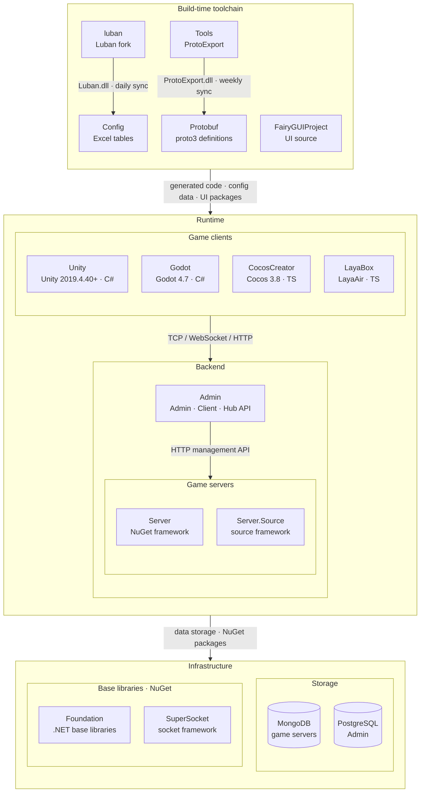

<div align="center">


# Luban

[](LICENSE.md)
[](https://github.com/GameFrameX/luban/releases)
[](https://gameframex.doc.alianblank.com)

[](https://discord.gg/VDWUjWMDw9)
[](https://github.com/GameFrameX/gameframex)
[](https://www.bilibili.com/video/BV1yrpeepEn7)
[](https://gitee.com/GameFrameX/gameframex)

인디 게임 개발자를 위한 올인원 솔루션 · 인디 개발자의 꿈을 실현

<br />

[문서](https://gameframex.doc.alianblank.com) · [빠른 시작](#빠른-시작) · QQ 그룹: 467608841 / 233840761

<br />

[English](README.md) \| [简体中文](README.zh-CN.md) \| [繁體中文](README.zh-TW.md) \| [日本語](README.ja.md) \| **한국어**

</div>

## 프로젝트 개요

luban은 강력하고, 사용하기 쉽고, 우아하며, 안정적인 게임 설정(configuration) 솔루션입니다. 소규모부터 초대형 게임 프로젝트까지, 간단한 것부터 복잡한 것까지 게임 설정 워크플로 요구를 충족하도록 설계되었습니다.

luban은 다양한 파일 형식을 처리할 수 있고, 주요 언어를 지원하며, 여러 내보내기 형식을 생성할 수 있고, 풍부한 데이터 검증 기능을 지원하고, 우수한 크로스 플랫폼 능력을 갖추고 있으며, 생성 속도가 매우 빠릅니다.

luban은 명확하고 우아한 생성 파이프라인 설계를 갖추고 있어 모듈화와 플러그인화가 잘 지원되며, 개발자가 손쉽게 secondary development(2차 개발)를 진행할 수 있습니다. 개발자는 luban을 자신의 설정 형식에 쉽게 맞춰 프로젝트 요구를 만족하는 강력한 설정 도구를 커스터마이징할 수 있습니다.

luban은 게임 설정 개발 워크플로를 표준화하여 기획자와 프로그래머의 작업 효율을 크게 높일 수 있습니다.

**5.0.0**부터 Luban은 AI Agent / IDE를 위한 **AI Native** 기능을 제공합니다: 공식 Skills, 머신 판독 가능 schema와 오류 보고, `Luban.Agent` CLI, 그리고 MCP Server를 통해 테이블 추가, schema 조회, 검증 및 생성을 Agent에 안정적으로 위임할 수 있습니다.

### GameFrameX 브랜치 설명

본 저장소는 [focus-creative-games/luban](https://github.com/focus-creative-games/luban)의 GameFrameX 브랜치로, 공식 **v5.1.0**을 병합했습니다: 공식 v4 / v5의 기반 리팩터링과 AI 기능을 흡수하는 동시에 아래의 GameFrameX 기능과 수정사항을 유지합니다. 브랜치 관련 문제는 [GameFrameX/luban Issues](https://github.com/GameFrameX/luban/issues)에 제출해 주세요.

#### 공식 버전과의 기능 차이

| 기능 | 설명 |
|:-----|:-----|
| split 코드 생성 타깃 | 기존 타깃 이름에 `-split`을 추가한 것으로, 정의와 런타임 코드를 분리된 파일로 출력합니다. [설명](#split-코드-생성-타깃-추가) 참고 |
| `cs-litjson` / `cs-litjson-split` | GameFrameX LitJson 기반의 C# 코드 생성 타깃입니다. [설명](#cs-litjson--cs-litjson-split-코드-생성-타깃-추가) 참고 |
| C# 런타임 형태 | `cs-bin`, `cs-dotnet-bin`, `cs-dotnet-json`, `cs-simple-json`, `cs-litjson` 및 그 `-split` 변형은 GameFrameX 런타임 형태를 생성합니다: 테이블 클래스가 `BaseDataTable<T>`를 상속하고, `Tables.Init(ConfigComponent)` 이후 `LoadAsync`로 비동기 로드합니다. `cs-code`, `cs-editor-json`, `cs-newtonsoft-json`은 이 형태를 사용하지 않습니다 |
| 파일 이름 자동 임포트 | `tableImporter.name=gameframex`, 파일 이름과 디렉터리로부터 테이블 이름, 그룹, 네임스페이스를 추론합니다. [설명](#자동-임포트용-파일-이름-확장-인식-추가) 참고 |
| 임포트 제외 디렉터리 | `--excludePath`. [설명](#임포트-제외-디렉터리-파라미터---excludepath-추가) 참고 |
| 로컬라이제이션 폴더 | `l10n.provider=gameframex`, `l10n.textFile.path`가 여러 폴더를 지원합니다. [설명](#로컬라이제이션-폴더-구성-지원-추가) 참고 |
| text 인라인 로컬라이제이션 | `l10n.inline.*`. [설명](#text-인라인-로컬라이제이션-지원) 참고 |
| enum 자동 수집 | `auto_extend`. [설명](#enum-자동-수집autoextend-기능-추가) 참고 |
| 동일 이름 `--xargs` 다중 값 | 같은 이름의 파라미터가 여러 번 나타날 수 있으며, 리스트 의미를 가진 파라미터는 나타난 순서대로 모든 값을 사용합니다 |
| 타깃 프레임워크 | `net10.0`으로 통일 (공식은 `net8.0`) |
| `Luban.GUI` | Avalonia 기반 데스크톱 임포트 도구 (`src/Luban.GUI`) |
| Docker 이미지 | [Docker](#docker) 참고 |

#### v5.1.0 병합 후 커스텀 수정 상태

| 수정 | 원래 커밋 | 병합 후 상태 |
|:-----|:-------|:-----------|
| l10n: `TranslateText`가 상속 관계에 따라 `virtual` / `override` 생성 | `24774645` | 유지 |
| l10n: 인라인 로컬라이제이션 xlsx 증분 병합, 변화 없을 때 재작성하지 않음, 소스 언어 value 변경 시 동기화 | `a8fd260c`, `b2a3e7b7`, `421349aa` | 유지 |
| cs-dotnet-json: 테이블 클래스가 `_loadFunc`를 자체 소유, 더 이상 기본 클래스 JSON 생성기를 체인하지 않음 | `e1f39884` | 유지 |
| cs-dotnet-json: non-null ref 필드 값 조회에 `TryGet` 사용 | `27b318b8` | 유지 |
| cs-dotnet-bin: list / one 테이블 `LoadAsync`에 `override` 추가, map 테이블 재로드 전 `LongDataMaps` 비움 | `ff138c33` | 유지 |
| cs-bin-split: `bean.def` 템플릿에서 불필요한 `using SimpleJSON` 제거 | `95b08b0b` | 유지 |
| table 템플릿 list / one 모드에서 중복 필드 및 생성자 생성 | `92aea61d` | 유지 |
| 바이트 읽기에 `ReadExactly`를 사용해 short read 방지 | `1e2333f3` | 유지 |
| 정수 필드의 `0x` 16진수 리터럴 지원 | `dd520088` | 공식 구현으로 대체됨 (공식 `42e5a380`, `LoadDataUtil.TryParseExcelIntFromNumberOrConstAlias`) |
| `map<int, _>`의 key에서 `0x` 16진수 리터럴 지원 | `a93ab40f` | 유지 (공식은 map key 파싱 경로를 다루지 않음) |
| Bean 전체 이름과 필드 이름이 같을 때 컴파일 오류, `[*items,,,*items]` 여러 줄 표시, 마지막 열 병합 셀 범위 초과 | `368c5344`, `d6c7a87c`, `534dd6c0` | 공식에 동등한 수정이 있으므로 공식 구현을 따름 |

### 기능

- 풍부한 소스 데이터 형식. excel 계열(csv, tsv, xls, xlsx, xlsm), json, xml, yaml, lua 등을 지원합니다
- 풍부한 내보내기 형식. binary, json, bson, xml, lua, yaml 등 형식의 데이터 생성을 지원합니다
- 강화된 excel 형식. 간단한 리스트, 하위 구조, 구조 리스트, 그리고 임의로 복잡한 깊은 중첩 구조를 간결하게 설정할 수 있습니다
- 완비된 타입 시스템. 일반적인 정규형 행렬 테이블뿐 아니라, **OOP 타입 상속 지원**으로 행동 트리, 스킬, 스토리, 던전 같은 복잡한 GamePlay 데이터를 유연하고 우아하게 표현할 수 있습니다
- 다양한 언어 지원. c#, java, go, cpp, lua, python, javascript, typescript, rust, php, erlang, godot 등 언어 코드 생성을 내장 지원하며, protobuf 같은 메시지 방식을 통해 다른 언어도 지원할 수 있습니다
- 주요 메시지 방식 지원. protobuf(schema + binary + json), flatbuffers(schema + json), msgpack(binary)
- 강력한 데이터 검증 능력. ref 참조 검사, path 리소스 경로, range 범위 검사 등
- 완비된 로컬라이제이션 지원
- **AI Native (5.0.0+)**. 공식 Agent Skills, `-c schema-json`, `--errorFormat json`, `Luban.Agent`(검증 / 테이블 조회 / describe), `Luban.Mcp`(IDE 도구 호출)
- 모든 주요 게임 엔진과 플랫폼 지원. Unity, Unreal, Cocos2x, Godot, WeChat 미니게임 등을 지원합니다
- 우수한 크로스 플랫폼 능력. Win, Linux, Mac 플랫폼에서 잘 동작합니다
- 모든 주요 핫업데이트 방식 지원. hybridclr, ilruntime, {x,t,s}lua, puerts 등
- 생성된 코드는 어떤 리플렉션 API도 호출하지 않아, [Obfuz](https://github.com/focus-creative-games/obfuz), Obfuscator, Confuser, .Net Refactor 등 흔한 코드 난독화 및 강화 도구와 호환됩니다
- 명확하고 우아한 생성 파이프라인으로, luban 기반의 2차 개발이 쉽고 자신의 프로젝트 스타일에 맞는 설정 도구를 커스터마이징할 수 있습니다

## 빠른 시작

### 설치

소스에서 빌드 (이 브랜치의 AI 도구는 세 개의 독립된 출력 디렉터리로 배포됩니다):

```bash
dotnet build src/Luban/Luban.csproj -c Release -o <out>/Luban
dotnet build src/Luban.Agent/Luban.Agent.csproj -c Release -o <out>/Luban.Agent
dotnet build src/Luban.Mcp/Luban.Mcp.csproj -c Release -o <out>/Luban.Mcp
```

또는 Docker 이미지 사용 (메인 프로그램 `Luban`만 포함하며, `Luban.Agent`와 `Luban.Mcp`는 포함하지 않습니다). 버전 tag는 Git tag와 일치하며, `v` 접두사 없는 SemVer 형식(예: `3.13.1`)을 사용합니다. 사용 가능한 버전은 [Releases](https://github.com/GameFrameX/luban/releases)에서 확인하세요.

| Registry | Image |
|:---------|:------|
| Docker Hub | `docker.io/gameframex/gameframex-luban:<version>` |
| GitHub Container Registry | `ghcr.io/gameframex/gameframex-luban:<version>` |
| Aliyun Container Registry | `<ALIYUN_REGISTRY_URL>/<ALIYUN_NAMESPACE>/gameframex-luban:<version>` |

```bash
docker run --rm docker.io/gameframex/gameframex-luban:<version> --help
```

현재 프로젝트 디렉터리에서 Luban을 실행할 때는 작업 디렉터리를 마운트할 수 있습니다:

```bash
docker run --rm -v "$PWD:/work" -w /work docker.io/gameframex/gameframex-luban:<version> --help
```

배포 이미지는 정확한 버전 tag만 제공하며, `latest`, `5`, `5.1` 같은 floating tag는 제공하지 않습니다.

### 테스트 실행

메인 저장소에 xUnit 통합 테스트가 포함되어 있습니다 (외부 `luban_examples`에 의존하지 않음):

```bash
dotnet test src/Luban.Tests/Luban.Tests.csproj
```

- 픽스처와 기대 출력: `tests/fixtures/`, `tests/golden/`
- golden 새로 고침 (내보내기 동작 변경 후): `pwsh tests/scripts/update-goldens.ps1` 또는 `bash tests/scripts/update-goldens.sh`
- 테스트 실행 시 환경 변수 `LUBAN_UPDATE_GOLDEN=1`을 설정하면 golden을 그 자리에서 갱신할 수도 있습니다

## 사용 예시

### AI 지원

공식 v5의 AI Native 기능은 v5.1.0과 함께 이 브랜치에 병합되었습니다:

| 기능 | 진입점 | 용도 |
|:-----|:-----|:-----|
| Agent Skills | [`ai/skills/`](./ai/skills) | 테이블 추가, 테이블 작성, schema 설계, 검증기, 생성 오류 해결, 런타임 로드 6개 스킬 |
| schema-json | `-c schema-json` | 머신 판독 가능한 `schema.json` 출력 |
| JSON 진단 | `--errorFormat json` | 실패 시 stderr로 구조화된 JSON 진단 출력 |
| Luban.Agent | [`src/Luban.Agent`](./src/Luban.Agent/README.md) | `capabilities` / `list-tables` / `describe` / `schema` / `validate`, stdout으로 단일 JSON 결과 출력 |
| Luban.Mcp | [`src/Luban.Mcp`](./src/Luban.Mcp/README.md) | stdio MCP Server, IDE / Agent에서 호출 |

#### MCP Server 시작

MCP 클라이언트 설정에 등록합니다 (`mcpServers` 형식, `<out>`은 실제 출력 디렉터리로 교체):

```json
{
  "mcpServers": {
    "luban": {
      "command": "dotnet",
      "args": ["<out>/Luban.Mcp/Luban.Mcp.dll"],
      "env": {
        "LUBAN_AGENT_DLL": "<out>/Luban.Agent/Luban.Agent.dll",
        "LUBAN_DLL": "<out>/Luban/Luban.dll",
        "LUBAN_DOC": "<luban-doc>/docs"
      }
    }
  }
}
```

- `LUBAN_AGENT_DLL`과 `LUBAN_DLL`은 반드시 설정해야 합니다: 설정하지 않으면 Luban.Mcp는 소스 트리 내 `bin/Release|Debug/net8.0`만 폴백으로 탐색하는데, 이 브랜치의 타깃 프레임워크는 `net10.0`이므로 폴백 경로가 적중하지 않습니다.
- `LUBAN_DOC`은 선택 사항이며, luban-doc 저장소의 `docs` 디렉터리를 가리켜 `search_docs`에서 사용합니다.
- 노출되는 도구: `list_tables` / `get_schema` / `describe` / `validate` / `generate` / `search_docs`, 파라미터는 [`src/Luban.Mcp/README.md`](./src/Luban.Mcp/README.md) 참고.

#### 스킬 사용

`ai/skills/` 아래의 스킬 디렉터리를 Agent의 스킬 디렉터리(예: `.cursor/skills/`, `~/.claude/skills/`)로 복사하세요. 자세한 내용은 [`ai/README.md`](./ai/README.md) 참고.

#### 명령줄

```bash
# 머신 판독 가능 schema 내보내기 (schema.json은 outputCodeDir로 출력)
dotnet <out>/Luban/Luban.dll --conf luban.conf -t all -c schema-json -d json -x outputCodeDir=<codeDir> -x outputDataDir=<dataDir>

# 실패 시 JSON으로 진단 출력 (stderr에 기록)
dotnet <out>/Luban/Luban.dll --conf luban.conf -t all -d json --errorFormat json -x outputDataDir=<dataDir>

# 검증만 수행, 파일 출력 없음
dotnet <out>/Luban.Agent/Luban.Agent.dll validate --conf luban.conf -t all
```

문서: [AI 지원 개요](https://www.datable.cn/docs/ai/overview) · [Skills](https://www.datable.cn/docs/ai/skills) · [Agent CLI](https://www.datable.cn/docs/ai/agent-cli) · [MCP](https://www.datable.cn/docs/ai/mcp) · [schema-json](https://www.datable.cn/docs/ai/schema-json)

### 수정 및 추가

#### split 코드 생성 타깃 추가

기존 코드 생성 타깃을 깨뜨리지 않으면서, 기존 타깃 이름에 `-split` 접미사를 붙인 코드 생성 타깃 묶음을 새로 추가했습니다.

split 타깃은 생성 코드를 더 세밀한 파일로 나눕니다: 정의 정보는 읽기, 리뷰, AI 컨텍스트용 Def 파일로 출력되고, 파싱, 로딩, 런타임 코드는 Impl 또는 런타임 파일에 남습니다. 이렇게 하면 단일 설정 타입에만 관심이 있을 때 해당 Def 파일만 읽으면 되고, 전체 전체 schema 파일을 읽을 필요가 없습니다.

##### 사용 시나리오

- **AI 보조 개발**: Def 파일을 AI 컨텍스트로 모델에 제공하면, 필드와 타입 정의만 포함하고 역직렬화 구현은 포함하지 않아 token 사용이 적고 신호 대 잡음비가 높습니다.
- **코드 리뷰와 일상 조회**: 특정 설정 테이블의 필드 의미만 확인하고 싶을 때, 해당 Def 파일을 바로 열면 되고 수천 줄짜리 전체 schema 파일에서 위치를 찾을 필요가 없습니다.
- **병합 충돌 감소**: schema 변경이 Def 파일에 집중되어 런타임 코드 변경과 서로 간섭하지 않아 diff가 더 집중됩니다.
- **비침투 공존**: 기존 비-split 타깃의 동작은 완전히 변하지 않으며, 두 종류의 타깃을 내보내기 target별로 각각 선택할 수 있습니다.

##### 사용 방법

타깃 이름 규칙은 「기존 코드 생성 타깃 + `-split`」이며, 내보내기 명령의 `--codeTarget`을 해당 split 타깃으로 바꾸면 되고 나머지 파라미터는 그대로입니다:

```text
dotnet Luban.dll --target client --dataTarget bin --codeTarget cs-bin-split --xargs outputDataDir=./Output/Data --xargs outputCodeDir=./Output/Code --conf ./luban.conf
```

Go 언어의 split 타깃은 모듈 이름을 추가로 지정해야 합니다:

```text
--xargs lubanGoModule=github.com/gameframex/config
```

각 언어 split 출력의 파일 이름 (`Tables` 네임스페이스의 `ItemConfig` 테이블 기준):

| 언어 | 정의 파일 (Def) | 런타임 파일 (Impl) |
|:-----|:---------------|:------------------|
| C# | `Tables/ItemConfig.Def.cs` | `Tables/ItemConfig.Impl.cs` (병합된 `ItemConfig.cs`는 더 이상 생성하지 않음) |
| Go | `Tables.ItemConfig.def.go` | `Tables.ItemConfig.impl.go` |
| Rust | `cfg/src/Tables.ItemConfig.Def.rs`, `Tables.TbItemConfig.Def.rs`, `Tables.Def.rs` | `cfg/src/tables.rs`, `cfg/src/lib.rs` |
| C++ | `Tables.ItemConfig.Def.h` | `schema.h`, `Tables.ItemConfig.Impl.cpp` |
| Java | `Tables/ItemConfigDef.java` (정의 동반 클래스) | `Tables/ItemConfig.java` |
| TypeScript | `Tables.ItemConfig.def.ts`, `Tables.def.ts` | `schema.ts` |
| Lua | `Tables.ItemConfig.def.lua` | 런타임 schema 파일 |
| PHP / GDScript | `Tables.ItemConfig.def.php` / `Tables.ItemConfig.def.gd` | 런타임 schema 파일 |

Def 파일은 정의 정보(필드, 타입, 상수 선언)만 포함하며, 역직렬화, 생성, 로딩 등의 런타임 코드는 포함하지 않습니다. 이 제약은 검수 스크립트의 assertion으로 보장됩니다.

이미 지원되는 split 타깃:

| 언어 | 타깃 |
|:-----|:-----|
| C# | `cs-simple-json-split`, `cs-litjson-split`, `cs-bin-split`, `cs-dotnet-json-split`, `cs-dotnet-bin-split` |
| Go | `go-json-split`, `go-bin-split` |
| Rust | `rust-json-split`, `rust-bin-split` |
| C++ | `cpp-rawptr-bin-split`, `cpp-sharedptr-bin-split` |
| Java | `java-json-split`, `java-bin-split` |
| TypeScript | `typescript-json-split`, `typescript-bin-split`, `typescript-protobuf-split` |
| Python | `python-json-split` |
| Lua | `lua-bin-split`, `lua-lua-split` |
| PHP | `php-json-split` |
| GDScript | `gdscript-json-split` |

분할 규칙은 언어 능력에 따라 일관된 의미를 유지합니다:

- C#, Go, C++는 Def/Impl 스타일 파일을 출력하여 정의 컨텍스트와 런타임 구현을 구분하기 쉽습니다.
- Java는 같은 public class를 파일 간에 나눌 수 없어서, 런타임 클래스와 `XxxDef` 정의 동반 클래스를 출력합니다.
- TypeScript, Python, Lua, PHP, GDScript는 런타임 schema 파일을 유지하면서, 각 타입에 해당하는 `*.def.*` 정의 파일을 추가로 출력합니다.

로컬 검수 스크립트:

```
BASE=/tmp/luban-split-code-targets-acceptance scripts/accept-split-code-targets.sh
```

#### cs-litjson / cs-litjson-split 코드 생성 타깃 추가

`cs-simple-json` / `cs-simple-json-split`(SimpleJSON 기반 코드를 계속 출력)을 그대로 유지하면서, `cs-litjson`과 `cs-litjson-split` 두 개의 독립적인 C# 코드 생성 타깃을 새로 추가했습니다. GameFrameX LitJson 패키지(네임스페이스 `GameFrameX.LitJSON.Runtime`, 메인 클래스 `JsonData` / `JsonMapper`) 기반의 역직렬화 코드를 출력합니다. 하위 호환이며, 기존 `cs-simple-json` 계열 타깃의 동작은 변하지 않고, 런타임에 이미 도입된 JSON 라이브러리에 맞는 타깃을 선택하면 됩니다.

| 타깃 | 대응하는 기존 타깃 | 런타임 의존성 | 출력 형태 |
|:-----|:------------|:----------|:---------|
| `cs-litjson` | `cs-simple-json` | `GameFrameX.LitJSON.Runtime` | 단일 파일, 정의와 런타임 코드를 병합 출력 |
| `cs-litjson-split` | `cs-simple-json-split` | `GameFrameX.LitJSON.Runtime` | split 출력, 정의 정보는 Def 파일, 런타임 코드는 Impl 파일 |

##### 사용 시나리오

- 런타임(특히 Unity 핫업데이트 레이어)이 이미 GameFrameX LitJson을 JSON 라이브러리로 통일해서, 설정 로딩과 프로젝트 나머지 부분이 같은 JSON 의존성을 공유하고 SimpleJSON을 함께 도입하고 싶지 않은 경우.
- split 수준(정의 / 런타임 분리)이 필요하면서 LitJson 역직렬화를 사용하는 C# 프로젝트.

##### 사용 방법

```text
--codeTarget cs-litjson        # 단일 파일 출력, 정의와 런타임 병합
--codeTarget cs-litjson-split  # Def / Impl 분리 출력
```

전제 조건: 런타임 프로젝트가 GameFrameX LitJson 패키지(네임스페이스 `GameFrameX.LitJSON.Runtime`, 메인 클래스 `JsonData` / `JsonMapper`)를 이미 도입했어야 합니다. 생성 코드는 해당 패키지만 의존하고 SimpleJSON은 의존하지 않습니다. `cs-simple-json` 계열 타깃과 서로 영향을 주지 않으며, 내보내기 target별로 각각 선택할 수 있습니다. `cs-litjson-split`은 위 split 타깃 목록의 C# 행에 포함되어 있습니다.

#### 로컬라이제이션 폴더 구성 지원 추가

프로젝트에서 협업 시 언어 테이블에 충돌이 자주 발생합니다. 이때는 Sheet 분리 문제가 아니라 모듈별로 테이블 파일 자체를 분리해야 합니다. 그래서 로컬라이제이션 폴더 구성이 폴더 아래의 모든 파일을 로컬라이제이션 파일로 인식하도록 지원합니다.

##### 예시 구성

- l10n.provider=`gameframex`

여기는 반드시 `gameframex`여야 하며, 그렇지 않으면 로컬라이제이션 파일 인식에 실패합니다.

- l10n.textFile.path=`./Excels/Tables/Localization/`

이 값은 반드시 폴더 경로여야 하며, 그렇지 않으면 로컬라이제이션 파일 인식에 실패합니다. 이 파라미터는 여러 폴더를 반복 지정할 수 있습니다.

내보내기 파라미터 참고:

```
--xargs l10n.provider=gameframex --xargs l10n.textFile.keyFieldName=key  --xargs l10n.textFile.path=./Excels/Tables/Localization/
```

##### 여러 폴더 로딩 (반복 파라미터 지원)

`l10n.textFile.path`는 여러 폴더를 반복 지정할 수 있어, 모듈별로 로컬라이제이션 테이블을 나누고 협업 충돌을 피할 수 있습니다:

```text
--xargs l10n.provider=gameframex --xargs l10n.textFile.keyFieldName=key
--xargs l10n.textFile.path=./Excels/Tables/LocalizationModuleA/
--xargs l10n.textFile.path=./Excels/Tables/LocalizationModuleB/
```

- 같은 이름의 `--xargs` 파라미터가 여러 번 나타날 수 있으며, 더 이상 duplicate 오류가 발생하지 않습니다. 값은 명령줄에 나타난 순서대로 로드됩니다.
- 리스트 의미가 아닌 다른 파라미터는 첫 번째로 나타난 값을 따릅니다.
- 각 폴더는 최상위 파일만 스캔하고 하위 디렉터리를 재귀하지 않습니다. 하위 디렉터리를 로드하려면 별도로 한 줄 더 구성하세요.
- 폴더 경로가 존재하지 않으면 오류 로그를 남기고 건너뛰며, 다른 폴더의 로딩에는 영향을 주지 않습니다.
- 서로 다른 파일에 같은 key가 나타나면 중복 오류 로그를 기록합니다.

#### text 인라인 로컬라이제이션 지원

일반 스칼라 `text`는 한 줄 또는 두 줄 작성 방식을 지원하며, 특별한 필드 표시를 추가할 필요가 없습니다:

```text
필드 이름 행: ... | name |        | description |        | id
타입 행:       ... | text |        | text        |        | int
데이터 행:     ... | key  | 중국어 값 | desc_key    | 설명 값 | 1
```

`text` 다음 열의 필드 이름과 타입이 동시에 비어 있을 때만 value 열로 인식되며, 그렇지 않으면 `text`는 한 열만 차지합니다. 단일 열 `text`의 value는 key와 같습니다. 한 테이블에 여러 `text` 필드가 있을 수 있지만, 일반 스칼라만 지원하며 `list<text>`, 배열, map, 여러 줄 text의 인라인 value는 지원하지 않습니다.

명시적으로 활성화하면, Luban은 비즈니스 데이터 로딩 완료 후 비즈니스 테이블 전체 이름을 기준으로 독립적인 로컬라이제이션 XLSX 파일을 생성합니다. Provider를 구성하지 않으면 파일만 생성하고 비즈니스 데이터의 key를 치환하지 않습니다:

```text
--xargs l10n.inline.enabled=true
--xargs l10n.inline.languageFieldName=zh_CN
--xargs l10n.inline.outputPath=Localization/Generated
--xargs l10n.inline.outputFileNameFormat=L-Localization-c-{table}.xlsx
```

`l10n.inline.outputPath`는 자동 생성되는 로컬라이제이션 `.xlsx` 파일 디렉터리를 지정하며, 상대 경로와 절대 경로를 지원합니다. 상대 경로는 Luban 프로세스의 현재 작업 디렉터리를 기준으로 합니다. 예:

```text
--xargs l10n.inline.outputPath=/path/to/Config/Excels/Local/Generated
```

`l10n.inline.outputFileNameFormat`은 자동 생성되는 로컬라이제이션 `.xlsx` 파일 이름 템플릿을 지정하며, 기본값은 `{table}.xlsx`입니다. 템플릿은 placeholder를 지원합니다 (모두 파일 이름 안전 처리가 적용됨):

- `{table}`: 비즈니스 테이블 전체 이름.
- `{source}`: 소스 xlsx 파일 이름 (확장자 제거).
- `{sourceDir}`: 소스 xlsx가 있는 디렉터리의 마지막 세그먼트.
- `{rawName}`: 소스 파일 이름을 `-`/`_`로 나눈 두 번째 세그먼트 (GameFrameXTableImporter의 rawTableName과 일치).
- `{comment}`: 소스 파일 이름에서 나눈 세 번째 세그먼트 이후를 `-`로 연결한 것.
- `{sheet}`: 소스 xlsx 내의 sheet 이름 (같은 파일에서 여러 sheet로 테이블을 나눌 때 구분용). sheet 개념이 없으면 비어 있습니다.

같은 테이블이 여러 소스 파일이나 같은 파일의 여러 sheet(분할 테이블)에서 올 수 있습니다. source 구성 요소로 그룹화해 파일 이름을 계산하며, 템플릿이 구분하지 않은 그룹은 자동으로 같은 출력 파일로 병합됩니다: 템플릿에 `{source}`/`{sheet}` 같은 구분성 placeholder가 포함되면 분할 테이블별로 나뉘고, `{table}`만 있으면 한 테이블당 하나의 파일을 유지합니다. source가 없을 때 `{source}`는 `{table}`로 퇴화됩니다. 출력 파일 이름을 GameFrameX 명명 규칙(예: `L-Localization-c-{namespace}.{테이블명}-{중국어 주석}.xlsx`)에 맞추려면 다음을 사용하세요:

```text
--xargs l10n.inline.outputFileNameFormat=L-Localization-c-{sourceDir}.{rawName}-{comment}.xlsx
```

입력 `Tables/D-ItemConfig-道具表-道具.xlsx` → 출력 `L-Localization-c-Tables.ItemConfig-道具表-道具.xlsx`.

##### 재생성 시 병합 의미

`l10n.inline.*`이 생성한 `.xlsx` 파일은 삭제되거나 통째로 덮어써지지 **않으며**, 증분 병합됩니다:

- **기존 xlsx에 이미 존재하는 key**: `l10n.inline.languageFieldName`이 지정한 소스 언어 열은 비즈니스 테이블을 따르며, value가 변하면 동기화 갱신됩니다. 다른 언어 열(번역가가 작성한 번역)은 변하지 않습니다.
- **비즈니스 테이블에 새로 추가된 key**: inline이 기록한 기본 value로 파일 끝에 추가됩니다.
- **비즈니스 테이블에서 삭제된 key**: 파일에 유지됩니다 (삭제하지 않음).
- **사용자가 수동으로 추가한 row**: 유지됩니다.
- **다국어 열**: 기존의 모든 열을 유지합니다. `l10n.inline.languageFieldName`이 지정한 열이 기존 파일에 없으면 metadata에서 해당 열을 확장합니다.
- **행 순서**: 기존 행은 원래 순서를 엄격히 유지하며, 새로 추가되는 행은 끝에 추가됩니다.
- **파일 재작성**: 새 key, 새 언어 열, 또는 소스 언어 value 변화가 있을 때만 xlsx를 다시 씁니다. 내용에 변화가 없으면 파일을 그대로 둡니다. 재작성 시 셀 텍스트와 `##` 주석 행은 유지되지만, 스타일 정보(색상, 열 너비, 메모 등)는 유지되지 않습니다.

간단히 말해: **추가만 하고, 삭제하지 않고, 재정렬하지 않음. 소스 언어 열은 비즈니스 테이블을 따르고 다른 언어 열은 덮어쓰지 않음**. 처음 inline을 실행한 후에는 생성 디렉터리를 번역 진입점으로 삼아야 합니다. 이후 실행마다 새로 나타난 key만 추가하고 소스 언어 value만 동기화하며, 이미 번역된 다른 언어 내용은 항상 유지됩니다.

생성 파일은 기존 Luban 테이블 형식을 사용하며, 기존 metadata 헤더 레이아웃을 유지하고 데이터 행은 B열부터 채워집니다 (A열은 비어 있음). 헤더 언어 열은 `key | zh_CN`이고 파일 확장자는 `.xlsx`입니다. 외부 수동 로컬라이제이션 테이블이 inline value보다 우선합니다. inline key가 서로 다른 테이블에 나타날 때 value는 반드시 일치해야 하며, 유효한 빈 value는 유지됩니다.

#### 자동 임포트용 파일 이름 확장 인식 추가

파일 이름 규칙을 통해 설정 테이블을 자동 등록합니다: 테이블 구조는 xlsx 안에 직접 작성하고, 파일 이름에 정렬 접두사, 테이블 이름, 내보내기 그룹, 주석 정보를 담으며, 디렉터리 구조와 함께 네임스페이스를 자동 추론해 XML에서 테이블을 하나씩 선언할 필요가 없습니다.

##### 사용 시나리오

- **schema 선언 불필요**: 새 설정 테이블을 추가할 때 명명 규칙에 따라 xlsx 파일만 만들면 되고, XML 정의를 함께 유지할 필요가 없습니다.
- **디렉터리가 곧 네임스페이스**: 모듈별로 디렉터리를 나눠 테이블을 구성하면 생성 코드의 네임스페이스로 자동 매핑됩니다.
- **다중 파일 분할 협업**: 같은 테이블의 데이터를 여러 파일로 나누고, 파일 이름으로 자동 병합해 한 테이블로 만듭니다.
- **그룹별 내보내기 필터링**: 파일 이름의 그룹 이름(예: `s` 클라이언트 / `c` 서버)으로, 같은 테이블 저장소에서 내보내기 target별로 다른 부분 집합을 출력합니다.

##### 내보내기 파라미터 (반드시 구성)

```
--xargs tableImporter.name=gameframex
```

##### 설명

형식 `[임의의 문자]-[내보내는 테이블 이름]-[내보내는 그룹 이름]-[테이블 이름 주석].xlsx`

- 테이블은 임의의 문자로 시작하고 `-`가 뒤따릅니다.
- 가운데 부분의 테이블 이름은 영문이어야 하고 공백이 없어야 하며, 밑줄은 사용할 수 있습니다.
- 내보내는 그룹 이름은 정의된 `s`, `c` 중 하나여야 하며, 선택 사항입니다.
- 이후의 테이블 이름 주석은 임의 길이가 가능합니다. 프로그램은 첫 번째 `-`와 두 번째 `-` 사이의 내용에 `Tb`를 붙여 최종 테이블 이름으로 사용합니다.

##### 예시

내보내는 테이블 이름:

- `L-Localization.xlsx` => `Tb`Localization
- `C-Achievement-成就表.xlsx` => `Tb`Achievement
- `C-Achievement-成就表-AAA.xlsx` => `Tb`Achievement
- `C-Achievement-成就表-AAA-BBB.xlsx` => `Tb`Achievement
- `C-Achievement-成就表-AAA-BBB-CCC.xlsx` => `Tb`Achievement

내보내는 그룹 테이블 이름:

- `C-Achievement-s-成就表.xlsx` => `Tb`Achievement, 현재 내보내기 대상이 `s`일 때만 내보냄
- `C-Achievement-c-成就表-AAA.xlsx` => `Tb`Achievement, 현재 내보내기 대상이 `c`일 때만 내보냄
- `C-Achievement-s-成就表-AAA-BBB.xlsx` => `Tb`Achievement, 현재 내보내기 대상이 `s`일 때만 내보냄
- `C-Achievement-c-成就表-AAA-BBB-CCC.xlsx` => `Tb`Achievement, 현재 내보내기 대상이 `c`일 때만 내보냄

##### 고급 구성과 동작 세부사항

`tableImporter.name=gameframex` 외에 다음 선택 파라미터도 지원합니다 (모두 기본값 있음):

| 파라미터 | 기본값 | 설명 |
|:-----|:-------|:-----|
| `tableImporter.filePattern` | `([a-zA-Z0-9]-.+)` | 파일 이름 매칭 정규식, 첫 번째 캡처 그룹이 테이블 이름 출처 |
| `tableImporter.tableNamespaceFormat` | `{0}` | 테이블 네임스페이스 형식 |
| `tableImporter.tableNameFormat` | `Tb{0}` | 테이블 이름 형식, 기본적으로 `Tb` 접두사 추가 |
| `tableImporter.valueTypeNameFormat` | `{0}` | 테이블 값 타입 이름 형식 |

- 데이터 디렉터리 아래의 모든 `xlsx` / `xls` / `xlsm` / `csv`를 재귀 스캔하며, 규칙에 해당하는 파일과 구성된 제외 경로는 자동으로 무시합니다.
- **디렉터리가 곧 네임스페이스**: 테이블이 있는 상대 디렉터리 경로를 `.`로 연결한 뒤 `-` / `_`로 나누고, 첫 번째 세그먼트를 네임스페이스로 사용합니다.
- **다중 파일 병합(분할 테이블)**: 네임스페이스와 테이블 이름이 모두 같은 여러 파일은 같은 테이블의 데이터 입력으로 병합됩니다.
- 테이블 이름(두 번째 세그먼트)에 중국어가 포함되면 빌드 시 바로 오류가 발생합니다.
- 그룹 이름(세 번째 세그먼트)은 구성에 정의된 그룹에 일치할 때만 유효하며, 현재 내보내기 target에 해당 그룹이 포함되어 있을 때만 이 테이블을 내보냅니다.

#### 임포트 제외 디렉터리 파라미터 `--excludePath` 추가

파일 이름 자동 임포트(`tableImporter.name=gameframex`)와 함께 사용하며, 데이터 디렉터리 스캔 시 지정 디렉터리 아래의 테이블 파일을 건너뜁니다. 반복 지정할 수 있습니다:

```text
--excludePath Local --excludePath Test
```

- 「데이터 디렉터리 기준 상대 경로」로 접두사 매칭하며, 대소문자를 구분하지 않습니다. `Local`은 `LocalExtra/`도 매칭합니다.
- 파라미터의 `/`는 일괄적으로 `\`로 변환됩니다. Windows에서는 다단계 디렉터리(예: `Local\UI\`)를 쓸 수 있습니다. macOS / Linux에서는 스캔된 상대 경로가 `/`를 사용하므로, 구분자가 없는 첫 단계 디렉터리 이름(예: `Local`)만 매칭됩니다.

#### enum 자동 수집(autoExtend) 기능 추가

새로운 `autoExtend` 기능: enum이 자동 확장으로 표시되면, 빌드 과정에서 해당 enum을 참조하는 모든 테이블 데이터를 자동 스캔하여 정의에 선언되지 않은 값을 수집하고 정식 enum 항목으로 추가합니다. 이렇게 하면 schema에 모든 값을 미리 열거할 필요가 없고, 값이 데이터와 함께 자연스럽게 늘어나며, 최종 생성되는 enum 코드에는 전체(사전 정의 + 자동 수집) enum 항목이 포함됩니다.

##### 적용 시나리오

- enum 값이 비즈니스 데이터와 함께 지속적으로 증가해, 매번 enum 정의를 다시 유지하고 싶지 않은 경우.
- 값의 「이름」이 「숫자」보다 더 중요한 경우 (json / 문자열 내보내기와 함께 사용 권장).

##### 구성 방법

XML schema (전용 속성):

```xml
<enum name="Color" auto_extend="true">
  <var name="RED" value="0" />
  <var name="GREEN" value="1" />
</enum>
```

Excel schema (기존 `tags` 열 재사용, 새 열 불필요): `__enums__`에서 해당 enum 행의 `tags` 열에 `auto_extend` 또는 `auto_extend=1`을 입력하면 활성화됩니다.

##### 동작 설명

- 수집 단계는 타입 컴파일 이후, 코드 생성과 정식 데이터 로딩 이전에 실행되며, 생성되는 enum 코드에는 자동 수집된 항목이 포함됩니다.
- 이름형 미정의 값(예: `PURPLE`)은 사전순으로 정렬한 뒤 순서대로 새 int 값을 할당받습니다 (`max(사전 정의 항목) + 1`씩 증가).
- 숫자형 미정의 값(예: `42`)은 `AUTO_VALUE_42`라는 이름으로 해당 리터럴 값을 유지합니다.
- 같은 입력 데이터에서는 결과가 완전히 결정적입니다 (로딩 순서와 무관).
- 자동 수집된 항목에는 `auto=1` 표시가 붙으며, 로그에 새 항목 상세가 출력됩니다.

##### 주의사항

- 자동 수집 항목의 int 값은 「현재 데이터 세트」에 의해 결정되므로, **데이터 증감으로 이미 할당된 값이 변할 수 있습니다**: binary 내보내기(int 인코딩)는 특히 주의해야 하며, json / 문자열 내보내기(이름 인코딩)는 영향을 받지 않습니다.
- `auto_extend`를 활성화하지 않은 enum의 동작은 완전히 변하지 않으며, 미정의 값을 만나면 기존 로직대로 오류를 발생시킵니다.

## 아키텍처

GameFrameX는 다음 저장소로 구성됩니다: 빌드 타임 도구 체인이 프로토콜과 설정 코드를 생성하고, 런타임은 게임 클라이언트, 게임 서버, 운영 백오피스가 협업합니다.



### 핵심 프로젝트

| 프로젝트 | 역할 | 기술 스택 | 산출물 및 연동 |
|------|------|------|------|
| [Unity](https://github.com/GameFrameX/GameFrameX.Unity) | Unity 클라이언트 프로젝트: GameFrameX UPM 소스에서 90개 이상의 프레임워크 컴포넌트를 필요에 따라 조립, HybridCLR 핫업데이트, 로그인, 인벤토리, 룸 등 예제 내장 | Unity 2019.4.40+, HybridCLR, YooAsset, FairyGUI, UniTask | Protobuf / Config / FairyGUIProject 산출물 소비. TCP 29100 + HTTP 28080으로 Server에 연결, HTTP 20808로 Admin Client API에 연결 |
| [Server](https://github.com/GameFrameX/GameFrameX.Server) | Actor 모델 게임 서버: Apps 지속 상태 레이어와 Hotfix 핫업데이트 로직 레이어를 엄격히 분리, 단일 프로세스 및 다중 프로세스 배포 지원 | .NET 10, MongoDB, Docker | TCP 29100 / WebSocket 29110 / HTTP 28080 수신. Admin에 메일, 아이템 지급, 플레이어 관리 등 HTTP 관리 인터페이스 제공 |
| [Admin](https://github.com/GameFrameX/GameFrameX.Admin) | 멀티 테넌트 운영 백오피스: Admin(20802) / Client(20808) / Hub(20806) 세 개의 host + Vue 관리 화면, 서버 관리, 공지, 메일, 주문 결제, 원격 설정, 온라인 운영 포괄 | .NET 10, SqlSugar, PostgreSQL, Vue 3.5, PrimeVue | 서버별 `HttpManageUrl`로 Server 호출. Client API는 게임 클라이언트에 전역 정보, 로그인, 결제 콜백 제공 |
| [luban](https://github.com/GameFrameX/luban) | Luban 설정 도구의 GameFrameX 브랜치: 공식 v5.1.0 병합, `gameframex` 테이블 임포터와 `cs-dotnet-json` / `cs-dotnet-bin` 등 생성 타깃 추가 | .NET 10, Scriban | Luban tar.gz와 Docker 이미지 배포. 매일 Config의 `Tools/`에 동기화 |
| [Config](https://github.com/GameFrameX/GameFrameX.Config) | 설정 테이블 저장소: Excel 데이터 테이블 + schema + 로컬라이제이션 테이블, 원 스크립트로 클라이언트/서버 코드와 데이터 생성 | Excel, Luban | `gen-client-*` → Unity; `gen-server-json` → Server; `gen-server-bin` → Server.Source; `gen-godot-json` / `gen-cocos-json` / `gen-laya-json` → Godot / CocosCreator / LayaBox |
| [Protobuf](https://github.com/GameFrameX/GameFrameX.Protobuf) | 통합 네트워크 프로토콜 정의: proto3, 파일 이름의 숫자 모듈 ID로 메시지와 오류 코드 구성 (양수는 클라이언트↔서버, 음수는 서버 내부) | proto3 | `Proto2CsExport_Server` → Server; `Proto2CsExport_Client` → Unity; `Proto2CsExport_Godot` / `Proto2TsExport_CocosCreator` / `Proto2TsExport_LayaBox` → 기타 클라이언트. push마다 CI가 6개 언어의 Release 배포 |
| [Tools](https://github.com/GameFrameX/GameFrameX.Tools) | ProtoExport 프로토콜 코드 생성기: C# / TypeScript / C++ / Lua / Go 5개 언어, CLI, Avalonia GUI, Docker 3가지 형태 제공 | .NET 10, Avalonia 12 | `ProtoExport.dll` 매주 Protobuf의 `Tools/`에 동기화. Docker 이미지 `gameframex/gameframex-tools` |

### 주변 시스템

| 프로젝트 | 역할 | 기술 스택 | 산출물 및 연동 |
|------|------|------|------|
| [Foundation](https://github.com/GameFrameX/GameFrameX.Foundation) | 모듈형 .NET 라이브러리 모음: 로컬라이제이션, JSON, 명령줄 파라미터, 로그, HTTP, 암호화, 해시, ORM 기반 엔티티, 멱등성 | .NET | NuGet 패키지로 Server, Server.Source, Admin, Tools에서 참조 |
| [SuperSocket](https://github.com/GameFrameX/GameFrameX.SuperSocket) | SuperSocket의 GameFrameX 브랜치: .NET 10 빌드 타깃, 의존성 주입 지원, 약한 네트워크 게임 트래픽을 위한 KCP / ReliableSession | .NET 10 | NuGet: Server(ClientEngine), Server.Source(Server / Kcp / Udp / WebSocket) |
| [Server.Source](https://github.com/GameFrameX/GameFrameX.Server.Source) | 프레임워크 레이어를 소스 형태로 저장소에 둔 서버 버전: 서비스 디스커버리, 프로세스 간 RemoteMessaging(TCP / KCP), 다중 프로세스 배포 | .NET 10, MongoDB, Docker | Config `gen-server-bin` 산출물 수신. `docker-compose.multi.yml`로 다중 프로세스 배포 |
| [Godot](https://github.com/GameFrameX/GameFrameX.Godot) | Godot .NET 클라이언트: 재사용 가능한 런타임 모듈, 에디터 플러그인, 핫업데이트 어셈블리 | Godot 4.7, C# | Config `gen-godot-json`, Protobuf `Proto2CsExport_Godot`. TCP 29100 / WebSocket 29110으로 Server에 연결 |
| [CocosCreator](https://github.com/GameFrameX/GameFrameX.CocosCreator) | Cocos Creator 클라이언트, Unity 버전을 기준으로 마이그레이션 | Cocos Creator 3.8, TypeScript | `npm run gen:proto` / `gen:config`가 Protobuf / Config 스크립트 호출. WebSocket으로 Server에 연결 |
| [LayaBox](https://github.com/GameFrameX/GameFrameX.LayaBox) | LayaBox 클라이언트 | LayaAir, TypeScript | Config `gen-laya-json`, Protobuf `Proto2TsExport_LayaBox`. WebSocket으로 Server에 연결 |
| [FairyGUIProject](https://github.com/GameFrameX/GameFrameX.FairyGUIProject) | FairyGUI 에디터 프로젝트: 모든 게임 UI의 디자인 소스 파일 | FairyGUI Editor | UI 패키지를 Unity `Assets/Bundles/UI`로, 코드를 `Assets/Hotfix/UI/FairyGUI/`로 배포 |

## 의존성

- 빌드 및 실행: .NET 10 SDK (이 브랜치의 타깃 프레임워크는 `net10.0`으로 통일).
- `cs-litjson` / `cs-litjson-split`이 생성한 코드는 GameFrameX LitJson 패키지(`GameFrameX.LitJSON.Runtime`)에 의존합니다.
- GameFrameX 런타임 형태(`cs-bin` 등 타깃)는 GameFrameX 런타임 라이브러리(`BaseDataTable<T>`, `Tables.Init(ConfigComponent)`, `LoadAsync`)에 의존합니다.
- 나머지 생성 타깃은 추가 런타임 의존성을 도입하지 않습니다.

## 문서 및 자료

- [공식 문서](https://www.datable.cn/docs/intro)
- [빠른 시작 안내](https://www.datable.cn/docs/guide/install)
- [AI 지원 (Skills / Agent / MCP / schema-json)](https://www.datable.cn/docs/ai/overview)
- [5.x 신기능 (4.x 대비)](https://www.datable.cn/docs/other/whats-new)
- **예제 프로젝트** ([github](https://github.com/focus-creative-games/luban_examples)) ([gitee](https://gitee.com/focus-creative-games/luban_examples))

저장소 내 AI 자료는 [`ai/`](./ai/README.md)를 참고하세요.

## 커뮤니티 및 지원

[](https://github.com/GameFrameX/gameframex)
[](https://discord.gg/VDWUjWMDw9)
[](https://www.linkedin.com/in/alianblank)
[](https://www.reddit.com/r/GameFrameX/)
[](https://x.com/alian_blank)
[](https://www.youtube.com/channel/UCD9QhSFJ5xZkn5NTSV-DVAw)
[](https://bsky.app/profile/alianblank.bsky.social)
[](https://www.bilibili.com/video/BV1yrpeepEn7)
[](https://gitee.com/GameFrameX/gameframex)
[]()

Luban 전용 지원:

- QQ 그룹: 692890842 (Luban 개발 교류 그룹)
- Discord: <https://discord.gg/dGY4zzGMJ4>
- 이메일: <luban@code-philosophy.com>

## 변경 로그

자세한 내용은 [CHANGELOG.md](CHANGELOG.md)를 참조하세요.

## 라이선스

자세한 내용은 [LICENSE.md](LICENSE.md) 파일을 참조하세요.

<!--
EN: See [LICENSE.md](LICENSE.md) for license information.
zh-CN: 详见 [LICENSE.md](LICENSE.md) 文件。
zh-TW: 詳見 [LICENSE.md](LICENSE.md) 檔案。
ja: 詳しくは [LICENSE.md](LICENSE.md) をご参照ください。
ko: 자세한 내용은 [LICENSE.md](LICENSE.md) 파일을 참조하세요.
-->
