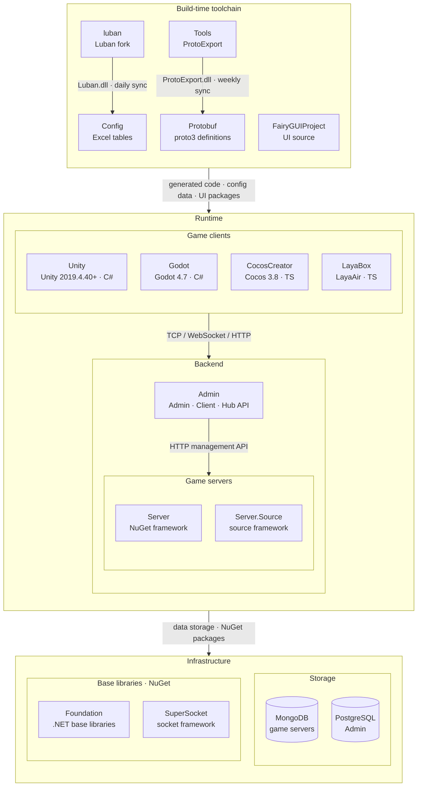

<div align="center">


# Luban

[](LICENSE.md)
[](https://github.com/GameFrameX/luban/releases)
[](https://gameframex.doc.alianblank.com)

[](https://discord.gg/VDWUjWMDw9)
[](https://github.com/GameFrameX/gameframex)
[](https://www.bilibili.com/video/BV1yrpeepEn7)
[](https://gitee.com/GameFrameX/gameframex)

獨立遊戲前後端一體化解決方案 · 獨立遊戲開發者的圓夢大使

<br />

[文檔](https://gameframex.doc.alianblank.com) · [快速開始](#快速開始) · QQ群: 467608841 / 233840761

<br />

[English](README.md) \| [简体中文](README.zh-CN.md) \| **繁體中文** \| [日本語](README.ja.md) \| [한국어](README.ko.md)

</div>

## 項目簡介

luban 是一個強大、易用、優雅、穩定的遊戲配置解決方案。它的設計目標是滿足從小型到超大型遊戲專案、從簡單到複雜的遊戲配置工作流程需求。

luban 可以處理豐富的檔案類型，支援主流的語言，可以產生多種匯出格式，支援豐富的資料校驗功能，具有良好的跨平台能力，並且產生速度極快。

luban 有清晰優雅的產生管線設計，支援良好的模組化與外掛化，方便開發者進行二次開發。開發者很容易就能將 luban 適配到自己的配置格式，客製出滿足專案要求的強大配置工具。

luban 標準化了遊戲配置開發工作流程，可以大幅提升策劃與程式人員的工作效率。

自 **5.0.0** 起，Luban 針對 AI Agent / IDE 提供 **AI Native** 能力：官方 Skills、機器可讀 schema 與錯誤報告、`Luban.Agent` CLI，以及 MCP Server，讓加表、查 schema、校驗與產生可以穩定地交給 Agent 完成。

### GameFrameX 分支說明

本倉庫是 [focus-creative-games/luban](https://github.com/focus-creative-games/luban) 的 GameFrameX 分支，已合併官方 **v5.1.0**：吸收官方 v4 / v5 的基座重構與 AI 能力，同時保留下列 GameFrameX 功能與修復。分支相關問題請提交到 [GameFrameX/luban Issues](https://github.com/GameFrameX/luban/issues)。

#### 與官方版本的功能差異

| 功能 | 說明 |
|:-----|:-----|
| split 程式碼產生目標 | 原目標名追加 `-split`，定義與執行時程式碼分檔案輸出，見[說明](#增加-split-程式碼產生目標) |
| `cs-litjson` / `cs-litjson-split` | 基於 GameFrameX LitJson 的 C# 程式碼產生目標，見[說明](#增加-cs-litjson--cs-litjson-split-程式碼產生目標) |
| C# 執行時形態 | `cs-bin`、`cs-dotnet-bin`、`cs-dotnet-json`、`cs-simple-json`、`cs-litjson` 及其 `-split` 變體產生 GameFrameX 執行時形態：表類別繼承 `BaseDataTable<T>`，`Tables.Init(ConfigComponent)` 後透過 `LoadAsync` 非同步載入；`cs-code`、`cs-editor-json`、`cs-newtonsoft-json` 不使用該形態 |
| 檔名自動導表 | `tableImporter.name=gameframex`，按檔名與目錄推導表名、分組與命名空間，見[說明](#增加自動導表的檔案名稱擴展識別) |
| 導表排除目錄 | `--excludePath`，見[說明](#增加導表排除目錄參數---excludepath) |
| 本地化資料夾 | `l10n.provider=gameframex`，`l10n.textFile.path` 支援多個資料夾，見[說明](#增加本地化的資料夾配置支援) |
| text 行內本地化 | `l10n.inline.*`，見[說明](#支援-text-行內本地化) |
| 枚舉自動收集 | `auto_extend`，見[說明](#增加枚舉自動收集autoextend能力) |
| 同名 `--xargs` 多值 | 同名參數可重複出現，列表語義的參數按出現順序取全部值 |
| 目標框架 | 統一為 `net10.0`（官方為 `net8.0`） |
| `Luban.GUI` | 基於 Avalonia 的桌面導表工具（`src/Luban.GUI`） |
| Docker 映像檔 | 見 [Docker](#docker) |

#### 自訂修復在合併 v5.1.0 後的狀態

| 修復 | 原提交 | 合併後狀態 |
|:-----|:-------|:-----------|
| l10n：`TranslateText` 按繼承關係產生 `virtual` / `override` | `24774645` | 保留 |
| l10n：行內本地化 xlsx 增量合併、無變化時不重寫、源語言 value 變化時同步 | `a8fd260c`、`b2a3e7b7`、`421349aa` | 保留 |
| cs-dotnet-json：表類別自持 `_loadFunc`，不再鏈結基底類別 JSON 建構 | `e1f39884` | 保留 |
| cs-dotnet-json：非空 ref 欄位取值改用 `TryGet` | `27b318b8` | 保留 |
| cs-dotnet-bin：list / one 表 `LoadAsync` 補 `override`；map 表重載前清空 `LongDataMaps` | `ff138c33` | 保留 |
| cs-bin-split：`bean.def` 模板移除多餘的 `using SimpleJSON` | `95b08b0b` | 保留 |
| table 模板 list / one 模式產生重複欄位與建構函式 | `92aea61d` | 保留 |
| 讀取位元組使用 `ReadExactly` 避免短讀 | `1e2333f3` | 保留 |
| 整型欄位支援 `0x` 十六進位字面量 | `dd520088` | 由官方實作取代（官方 `42e5a380`，`LoadDataUtil.TryParseExcelIntFromNumberOrConstAlias`） |
| `map<int, _>` 的 key 支援 `0x` 十六進位字面量 | `a93ab40f` | 保留（官方未覆蓋 map key 解析路徑） |
| Bean 全名與欄位同名時編譯錯誤、`[*items,,,*items]` 多行標記、末列合併儲存格越界 | `368c5344`、`d6c7a87c`、`534dd6c0` | 官方已有等價修復，以官方實作為準 |

### 功能特性

- 豐富的來源資料格式。支援 excel 族（csv、tsv、xls、xlsx、xlsm）、json、xml、yaml、lua 等
- 豐富的匯出格式。支援產生 binary、json、bson、xml、lua、yaml 等格式資料
- 增強的 excel 格式。可以簡潔地配置出像簡單列表、子結構、結構列表，以及任意複雜的深層次巢狀結構
- 完備的型別系統。不僅能表達常見的規範行列表，由於**支援 OOP 型別繼承**，能靈活優雅地表達行為樹、技能、劇情、副本之類複雜的 GamePlay 資料
- 支援多種語言。內建支援產生 c#、java、go、cpp、lua、python、javascript、typescript、rust、php、erlang、godot 等語言程式碼，同時還能透過 protobuf 之類訊息方案支援其他語言
- 支援主流的訊息方案。protobuf（schema + binary + json）、flatbuffers（schema + json）、msgpack（binary）
- 強大的資料校驗能力。ref 引用檢查、path 資源路徑、range 範圍檢查等等
- 完善的本地化支援
- **AI Native（5.0.0+）**。官方 Agent Skills、`-c schema-json`、`--errorFormat json`、`Luban.Agent`（校驗 / 查表 / describe）、`Luban.Mcp`（IDE 工具呼叫）
- 支援所有主流的遊戲引擎與平台。支援 Unity、Unreal、Cocos2x、Godot、微信小遊戲等
- 良好的跨平台能力。能在 Win、Linux、Mac 平台良好執行
- 支援所有主流的熱更新方案。hybridclr、ilruntime、{x,t,s}lua、puerts 等
- 產生的程式碼未呼叫任何反射介面，相容 [Obfuz](https://github.com/focus-creative-games/obfuz)、Obfuscator、Confuser、.Net Refactor 等常見程式碼混淆與加固工具
- 清晰優雅的產生管線，很容易在 luban 基礎上進行二次開發，客製出適合自己專案風格的配置工具

## 快速開始

### 安裝

從原始碼建置（本分支的 AI 工具以三個獨立輸出目錄發布）：

```bash
dotnet build src/Luban/Luban.csproj -c Release -o <out>/Luban
dotnet build src/Luban.Agent/Luban.Agent.csproj -c Release -o <out>/Luban.Agent
dotnet build src/Luban.Mcp/Luban.Mcp.csproj -c Release -o <out>/Luban.Mcp
```

或使用 Docker 映像檔（只包含主程式 `Luban`，不含 `Luban.Agent` 與 `Luban.Mcp`）。版本 tag 與 Git tag 保持一致，使用無 `v` 前綴的 SemVer 格式，例如 `3.13.1`；可用版本見 [Releases](https://github.com/GameFrameX/luban/releases)。

| Registry | Image |
|:---------|:------|
| Docker Hub | `docker.io/gameframex/gameframex-luban:<version>` |
| GitHub Container Registry | `ghcr.io/gameframex/gameframex-luban:<version>` |
| Aliyun Container Registry | `<ALIYUN_REGISTRY_URL>/<ALIYUN_NAMESPACE>/gameframex-luban:<version>` |

```bash
docker run --rm docker.io/gameframex/gameframex-luban:<version> --help
```

在當前專案目錄中執行 Luban 時，可以掛載工作目錄：

```bash
docker run --rm -v "$PWD:/work" -w /work docker.io/gameframex/gameframex-luban:<version> --help
```

發布映像檔只提供精確版本 tag，不提供 `latest`、`5`、`5.1` 等浮動 tag。

### 執行測試

主倉內建 xUnit 整合測試（不依賴外部 `luban_examples`）：

```bash
dotnet test src/Luban.Tests/Luban.Tests.csproj
```

- 測試夾具與期望輸出：`tests/fixtures/`、`tests/golden/`
- 重新整理 golden（修改匯出行為後）：`pwsh tests/scripts/update-goldens.ps1` 或 `bash tests/scripts/update-goldens.sh`
- 也可在跑測試時設定環境變數 `LUBAN_UPDATE_GOLDEN=1` 就地更新 golden

## 使用範例

### AI 支援

官方 v5 的 AI Native 能力已隨 v5.1.0 合入本分支：

| 能力 | 入口 | 用途 |
|:-----|:-----|:-----|
| Agent Skills | [`ai/skills/`](./ai/skills) | 加表、填表、schema 設計、校驗器、產生排錯、執行時載入 6 個技能 |
| schema-json | `-c schema-json` | 輸出機器可讀的 `schema.json` |
| JSON 診斷 | `--errorFormat json` | 失敗時向 stderr 輸出結構化 JSON 診斷 |
| Luban.Agent | [`src/Luban.Agent`](./src/Luban.Agent/README.md) | `capabilities` / `list-tables` / `describe` / `schema` / `validate`，stdout 輸出單一 JSON 結果 |
| Luban.Mcp | [`src/Luban.Mcp`](./src/Luban.Mcp/README.md) | stdio MCP Server，供 IDE / Agent 呼叫 |

#### 啟動 MCP Server

在 MCP 用戶端配置中註冊（`mcpServers` 格式，`<out>` 換成實際輸出目錄）：

```json
{
  "mcpServers": {
    "luban": {
      "command": "dotnet",
      "args": ["<out>/Luban.Mcp/Luban.Mcp.dll"],
      "env": {
        "LUBAN_AGENT_DLL": "<out>/Luban.Agent/Luban.Agent.dll",
        "LUBAN_DLL": "<out>/Luban/Luban.dll",
        "LUBAN_DOC": "<luban-doc>/docs"
      }
    }
  }
}
```

- 必須設定 `LUBAN_AGENT_DLL` 與 `LUBAN_DLL`：未設定時 Luban.Mcp 只會回退查找原始碼樹內的 `bin/Release|Debug/net8.0`，本分支目標框架為 `net10.0`，回退路徑不會命中。
- `LUBAN_DOC` 可選，指向 luban-doc 倉庫的 `docs` 目錄，供 `search_docs` 使用。
- 暴露的工具：`list_tables` / `get_schema` / `describe` / `validate` / `generate` / `search_docs`，參數見 [`src/Luban.Mcp/README.md`](./src/Luban.Mcp/README.md)。

#### 使用技能

把 `ai/skills/` 下的技能目錄複製到 Agent 的技能目錄（如 `.cursor/skills/`、`~/.claude/skills/`），詳見 [`ai/README.md`](./ai/README.md)。

#### 命令列

```bash
# 导出机器可读 schema（schema.json 输出到 outputCodeDir）
dotnet <out>/Luban/Luban.dll --conf luban.conf -t all -c schema-json -d json -x outputCodeDir=<codeDir> -x outputDataDir=<dataDir>

# 失败时以 JSON 输出诊断（写入 stderr）
dotnet <out>/Luban/Luban.dll --conf luban.conf -t all -d json --errorFormat json -x outputDataDir=<dataDir>

# 只校验、不输出文件
dotnet <out>/Luban.Agent/Luban.Agent.dll validate --conf luban.conf -t all
```

文檔：[AI 支援總覽](https://www.datable.cn/docs/ai/overview) · [Skills](https://www.datable.cn/docs/ai/skills) · [Agent CLI](https://www.datable.cn/docs/ai/agent-cli) · [MCP](https://www.datable.cn/docs/ai/mcp) · [schema-json](https://www.datable.cn/docs/ai/schema-json)

### 修改與增加

#### 增加 split 程式碼產生目標

在不破壞原有程式碼產生目標的前提下，新增一組以原目標名稱追加 `-split` 後綴的程式碼產生目標。

split 目標用於將產生的程式碼拆分為更細粒度的檔案：定義資訊輸出到面向閱讀、審查與 AI 上下文使用的 Def 檔案中，解析、載入與執行時程式碼保留在 Impl 或執行時檔案中。這樣在只關注單一配置型別時，可以讀取對應的 Def 檔案，而不需要讀取完整的全量 schema 檔案。

##### 使用情境

- **AI 輔助開發**：把 Def 檔案作為 AI 上下文提供給模型，只含欄位與型別定義、不含反序列化實作，token 佔用小、信噪比高。
- **程式碼審查與日常查閱**：只想確認某個配置表的欄位含義時，直接開啟對應的 Def 檔案，不必在幾千行的全量 schema 檔案裡定位。
- **降低合併衝突**：schema 調整集中在 Def 檔案，與執行時程式碼的改動互不干擾，diff 更聚焦。
- **無侵入共存**：原有非 split 目標行為完全不變，兩種目標可按匯出 target 分別選擇。

##### 使用方式

目標命名規則為「原程式碼產生目標 + `-split`」，把匯出命令中的 `--codeTarget` 換成對應 split 目標即可，其餘參數不變：

```text
dotnet Luban.dll --target client --dataTarget bin --codeTarget cs-bin-split --xargs outputDataDir=./Output/Data --xargs outputCodeDir=./Output/Code --conf ./luban.conf
```

Go 語言的 split 目標需要額外指定模組名：

```text
--xargs lubanGoModule=github.com/gameframex/config
```

各語言 split 輸出的檔案命名（以 `Tables` 命名空間下的 `ItemConfig` 表為例）：

| 語言 | 定義檔案（Def） | 執行時檔案（Impl） |
|:-----|:---------------|:------------------|
| C# | `Tables/ItemConfig.Def.cs` | `Tables/ItemConfig.Impl.cs`（不再產生合併的 `ItemConfig.cs`） |
| Go | `Tables.ItemConfig.def.go` | `Tables.ItemConfig.impl.go` |
| Rust | `cfg/src/Tables.ItemConfig.Def.rs`、`Tables.TbItemConfig.Def.rs`、`Tables.Def.rs` | `cfg/src/tables.rs`、`cfg/src/lib.rs` |
| C++ | `Tables.ItemConfig.Def.h` | `schema.h`、`Tables.ItemConfig.Impl.cpp` |
| Java | `Tables/ItemConfigDef.java`（定義伴生類別） | `Tables/ItemConfig.java` |
| TypeScript | `Tables.ItemConfig.def.ts`、`Tables.def.ts` | `schema.ts` |
| Lua | `Tables.ItemConfig.def.lua` | 執行時 schema 檔案 |
| PHP / GDScript | `Tables.ItemConfig.def.php` / `Tables.ItemConfig.def.gd` | 執行時 schema 檔案 |

Def 檔案只包含定義資訊（欄位、型別、常數宣告），不含反序列化、建構、載入等執行時程式碼；該約束由驗收腳本斷言保證。

已支援的 split 目標：

| 語言 | 目標 |
|:-----|:-----|
| C# | `cs-simple-json-split`, `cs-litjson-split`, `cs-bin-split`, `cs-dotnet-json-split`, `cs-dotnet-bin-split` |
| Go | `go-json-split`, `go-bin-split` |
| Rust | `rust-json-split`, `rust-bin-split` |
| C++ | `cpp-rawptr-bin-split`, `cpp-sharedptr-bin-split` |
| Java | `java-json-split`, `java-bin-split` |
| TypeScript | `typescript-json-split`, `typescript-bin-split`, `typescript-protobuf-split` |
| Python | `python-json-split` |
| Lua | `lua-bin-split`, `lua-lua-split` |
| PHP | `php-json-split` |
| GDScript | `gdscript-json-split` |

拆分規則按語言能力保持一致語義：

- C#、Go、C++ 輸出 Def/Impl 風格檔案，便於區分定義上下文與執行時實作。
- Java 由於不支援跨檔案拆分同一個 public class，輸出執行時類別和 `XxxDef` 定義伴生類別。
- TypeScript、Python、Lua、PHP、GDScript 保留執行時 schema 檔案，同時額外輸出每個型別對應的 `*.def.*` 定義檔案。

本地驗收腳本：

```
BASE=/tmp/luban-split-code-targets-acceptance scripts/accept-split-code-targets.sh
```

#### 增加 cs-litjson / cs-litjson-split 程式碼產生目標

在保留 `cs-simple-json` / `cs-simple-json-split`（繼續輸出基於 SimpleJSON 的程式碼）不變的前提下，新增 `cs-litjson` 與 `cs-litjson-split` 兩個獨立的 C# 程式碼產生目標，輸出基於 GameFrameX LitJson 套件（命名空間 `GameFrameX.LitJSON.Runtime`，主類別 `JsonData` / `JsonMapper`）的反序列化程式碼。向下相容，原有 `cs-simple-json` 系列目標行為不變，按執行時已引入的 JSON 庫選擇對應目標即可。

| 目標 | 對應的原目標 | 執行時依賴 | 輸出形式 |
|:-----|:------------|:----------|:---------|
| `cs-litjson` | `cs-simple-json` | `GameFrameX.LitJSON.Runtime` | 單一檔案，定義與執行時程式碼合併輸出 |
| `cs-litjson-split` | `cs-simple-json-split` | `GameFrameX.LitJSON.Runtime` | split 輸出，定義資訊在 Def 檔案，執行時程式碼在 Impl 檔案 |

##### 使用情境

- 執行時（尤其是 Unity 熱更新層）已統一使用 GameFrameX LitJson 作為 JSON 庫，希望配置載入與專案其餘部分共用同一套 JSON 依賴，不再同時引入 SimpleJSON。
- 需要 split 粒度（定義 / 執行時分離）且使用 LitJson 反序列化的 C# 工程。

##### 使用方式

```text
--codeTarget cs-litjson        # 单文件输出，定义与运行时合并
--codeTarget cs-litjson-split  # Def / Impl 分离输出
```

前提：執行時工程已引入 GameFrameX LitJson 套件（命名空間 `GameFrameX.LitJSON.Runtime`，主類別 `JsonData` / `JsonMapper`）。產生的程式碼只依賴該套件，不依賴 SimpleJSON；與 `cs-simple-json` 系列目標互不影響，可按匯出 target 分別選擇。`cs-litjson-split` 已包含在上文 split 目標列表的 C# 行中。

#### 增加本地化的資料夾配置支援

在專案中，經常會出現語言表在協作時有衝突的情況。這時就需要按照每個模組來做表格檔案本身的分離，已經不是 Sheet 分離的問題了。所以將本地化資料夾配置支援資料夾下的所有檔案都識別為本地化檔案。

##### 範例配置

- l10n.provider=`gameframex`

這裡必須為 `gameframex`，否則會導致本地化檔案識別失敗。

- l10n.textFile.path=`./Excels/Tables/Localization/`

這裡的值必須為資料夾路徑，否則會導致本地化檔案識別失敗。該參數支援重複指定多個資料夾。

匯出參數參考：

```
--xargs l10n.provider=gameframex --xargs l10n.textFile.keyFieldName=key  --xargs l10n.textFile.path=./Excels/Tables/Localization/
```

##### 多資料夾載入（支援重複參數）

`l10n.textFile.path` 支援重複指定多個資料夾，用於按模組拆分本地化表、避免協作衝突：

```text
--xargs l10n.provider=gameframex --xargs l10n.textFile.keyFieldName=key
--xargs l10n.textFile.path=./Excels/Tables/LocalizationModuleA/
--xargs l10n.textFile.path=./Excels/Tables/LocalizationModuleB/
```

- 同名 `--xargs` 參數可以重複出現，不再報 duplicate 錯誤；值按命令列出現順序依次載入。
- 非列表語義的其他參數以第一次出現的值為準。
- 每個資料夾只掃描頂層檔案，不遞迴子目錄；需要載入子目錄時單獨再配置一行。
- 資料夾路徑不存在時記錄錯誤日誌並跳過，不影響其他資料夾的載入。
- 不同檔案中出現相同 key 時記錄重複錯誤日誌。

#### 支援 text 行內本地化

普通純量 `text` 支援一列或兩列寫法，不需要增加特殊欄位標記：

```text
字段名行：... | name |        | description |        | id
类型行：  ... | text |        | text        |        | int
数据行：  ... | key  | 中文值  | desc_key    | 描述值  | 1
```

只有當 `text` 後一列的欄位名與型別同時為空時，才會將其識別為 value 列；否則 `text` 只佔一列。單列 `text` 的 value 等於 key。一個表中可以有多個 `text` 欄位，但只支援普通純量，不支援 `list<text>`、陣列、map 或多行 text 的行內 value。

顯式開啟後，Luban 會在業務資料載入完成後按業務表完整名稱產生獨立的本地化 XLSX 檔案；未配置 Provider 時只產生檔案，不替換業務資料中的 key：

```text
--xargs l10n.inline.enabled=true
--xargs l10n.inline.languageFieldName=zh_CN
--xargs l10n.inline.outputPath=Localization/Generated
--xargs l10n.inline.outputFileNameFormat=L-Localization-c-{table}.xlsx
```

`l10n.inline.outputPath` 用於指定自動產生的本地化 `.xlsx` 檔案目錄，支援相對路徑與絕對路徑。相對路徑以 Luban 程序的當前工作目錄為基準，例如：

```text
--xargs l10n.inline.outputPath=/path/to/Config/Excels/Local/Generated
```

`l10n.inline.outputFileNameFormat` 用於指定自動產生的本地化 `.xlsx` 檔名模板，預設 `{table}.xlsx`。模板支援佔位符（均會做檔名安全清洗）：

- `{table}`：業務表完整名。
- `{source}`：來源 xlsx 檔名（去副檔名）。
- `{sourceDir}`：來源 xlsx 所在目錄的最後一段。
- `{rawName}`：來源檔名按 `-`/`_` 拆出的第二段（與 GameFrameXTableImporter 的 rawTableName 一致）。
- `{comment}`：來源檔名拆出的第三段及之後，用 `-` 拼接。
- `{sheet}`：來源 xlsx 內的 sheet 名（同一檔案多 sheet 分表時區分用）；無 sheet 概念時為空。

同一個表可能來自多個來源檔案或同一檔案的多個 sheet（分表）。按 source 部件分組後計算檔名，模板未區分的組自動合併到同一輸出檔案：模板包含 `{source}`/`{sheet}` 等區分性佔位符時按分表拆分，只含 `{table}` 時保持一表一檔案。缺 source 時 `{source}` 退化到 `{table}`。需要輸出檔名按 GameFrameX 命名約定（如 `L-Localization-c-{namespace}.{表名}-{中文註釋}.xlsx`）時使用：

```text
--xargs l10n.inline.outputFileNameFormat=L-Localization-c-{sourceDir}.{rawName}-{comment}.xlsx
```

輸入 `Tables/D-ItemConfig-道具表-道具.xlsx` → 輸出 `L-Localization-c-Tables.ItemConfig-道具表-道具.xlsx`。

##### 重新生成時的合併語義

`l10n.inline.*` 產生的 `.xlsx` 檔案**不會**被刪除或整表覆蓋，而是增量合併：

- **現有 xlsx 已存在的 key**：`l10n.inline.languageFieldName` 指定的源語言列以業務表為準，value 變化時同步更新；其他語言列（譯者填寫的翻譯）保持不變。
- **業務表新增的 key**：以 inline 寫入的預設 value 追加到檔案末尾。
- **業務表刪除的 key**：檔案裡保留（不刪）。
- **使用者手工加的 row**：保留。
- **多語言列**：保留所有現有列；如 `l10n.inline.languageFieldName` 指定的列在現有檔案裡缺失，則在 metadata 中擴展該列。
- **行順序**：現有行嚴格保持原順序；新追加的行追加到末尾。
- **檔案重寫**：只有出現新 key、新語言列或源語言 value 變化時才重寫 xlsx，內容無變化時檔案保持不動；重寫時儲存格文字與 `##` 註釋行保留，但樣式資訊（顏色、欄寬、批註等）不會保留。

簡單說：**只追加，不刪、不重排；源語言列跟隨業務表，其他語言列不覆蓋**。第一次跑 inline 後，應該把產生目錄當作翻譯入口；後續每次跑只會追加新出現的 key 並同步源語言 value，已翻譯的其他語言內容始終保留。

產生檔案使用現有 Luban 表格式，保持原有 metadata 表頭佈局，資料行從 B 列開始填充（A 列為空），表頭語言列為 `key | zh_CN`，檔案副檔名為 `.xlsx`。外部人工本地化表優先於 inline value；inline key 在不同表中出現時 value 必須一致，合法空 value 會被保留。

#### 增加自動導表的檔案名稱擴展識別

透過檔名約定自動註冊配置表：表結構直接寫在 xlsx 內，檔名攜帶排序前綴、表名、匯出組與註釋資訊，配合目錄結構自動推導命名空間，無需在 XML 中逐表宣告。

##### 使用情境

- **免 schema 宣告**：新增配置表時只需按命名規範新建 xlsx 檔案，不必同步維護 XML 定義。
- **目錄即命名空間**：按模組分目錄組織表格，自動映射為產生程式碼的命名空間。
- **多檔案分表協作**：同一張表的資料拆到多個檔案，按檔名自動合併為一張表。
- **按組過濾匯出**：透過檔名中的組名（如 `s` 用戶端 / `c` 伺服器端），同一套表倉按匯出 target 輸出不同子集。

##### 匯出參數（必須配置）

```
--xargs tableImporter.name=gameframex
```

##### 說明

格式 `[任意字母]-[匯出的表名稱]-[匯出的組名]-[表名稱註釋].xlsx`

- 表格以任意字母 `-` 開頭。
- 中間部分的表名稱為英文且不能有空格，可以有底線。
- 匯出的組名稱必須是已定義的 `s`、`c` 之一，可選。
- 後面表名稱註釋可以接任意長度。程式只取第一個 `-` 和第二個 `-` 之間的內容加上 `Tb` 作為最終表名稱。

##### 範例

匯出的表名稱：

- `L-Localization.xlsx` => `Tb`Localization
- `C-Achievement-成就表.xlsx` => `Tb`Achievement
- `C-Achievement-成就表-AAA.xlsx` => `Tb`Achievement
- `C-Achievement-成就表-AAA-BBB.xlsx` => `Tb`Achievement
- `C-Achievement-成就表-AAA-BBB-CCC.xlsx` => `Tb`Achievement

匯出的組表名稱：

- `C-Achievement-s-成就表.xlsx` => `Tb`Achievement，當前匯出目標為 `s` 時才會匯出
- `C-Achievement-c-成就表-AAA.xlsx` => `Tb`Achievement，當前匯出目標為 `c` 時才會匯出
- `C-Achievement-s-成就表-AAA-BBB.xlsx` => `Tb`Achievement，當前匯出目標為 `s` 時才會匯出
- `C-Achievement-c-成就表-AAA-BBB-CCC.xlsx` => `Tb`Achievement，當前匯出目標為 `c` 時才會匯出

##### 進階配置與行為細節

除 `tableImporter.name=gameframex` 外，還支援以下可選參數（均有預設值）：

| 參數 | 預設值 | 說明 |
|:-----|:-------|:-----|
| `tableImporter.filePattern` | `([a-zA-Z0-9]-.+)` | 檔名匹配正則，第一個捕獲組作為表名來源 |
| `tableImporter.tableNamespaceFormat` | `{0}` | 表命名空間格式 |
| `tableImporter.tableNameFormat` | `Tb{0}` | 表名格式，預設加 `Tb` 前綴 |
| `tableImporter.valueTypeNameFormat` | `{0}` | 表值型別名格式 |

- 遞迴掃描資料目錄下所有 `xlsx` / `xls` / `xlsm` / `csv`，自動忽略約定規則的檔案與配置的排除路徑。
- **目錄即命名空間**：表所在相對目錄路徑轉為 `.` 分隔後按 `-` / `_` 拆分，取第一段作為命名空間。
- **多檔案合併（分表）**：命名空間與表名都相同的多個檔案，合併為同一張表的資料輸入。
- 表名（第二段）包含中文時建置直接報錯。
- 組名（第三段）只有命中配置中已定義的組時才生效，且僅當當前匯出 target 包含該組時才會匯出該表。

#### 增加導表排除目錄參數 `--excludePath`

配合檔名自動導表（`tableImporter.name=gameframex`）使用，掃描資料目錄時跳過指定目錄下的表格檔案，可重複指定：

```text
--excludePath Local --excludePath Test
```

- 按「相對資料目錄的路徑」做前綴匹配，不區分大小寫；`Local` 也會匹配 `LocalExtra/`。
- 參數中的 `/` 會被統一轉換為 `\`。Windows 下可寫多級目錄（如 `Local\UI\`）；macOS / Linux 下掃描得到的相對路徑使用 `/`，只有不帶分隔符的首層目錄名（如 `Local`）能命中。

#### 增加枚舉自動收集（autoExtend）能力

新增 `autoExtend` 能力：當枚舉標記為自動擴展時，建置過程會自動掃描所有引用該枚舉的表資料，把未在定義中宣告的值收集起來，作為正式枚舉項加入。這樣無需在 schema 中預先枚舉所有取值，值隨資料自然生長，最終產生的枚舉程式碼會包含全部（預定義 + 自動收集）的枚舉項。

##### 適用情境

- 枚舉取值隨業務資料持續增長，不希望每次都回頭維護枚舉定義。
- 取值的「名字」比「數字」更重要（建議配合 json / 字串匯出使用）。

##### 配置方式

XML schema（專用屬性）：

```xml
<enum name="Color" auto_extend="true">
  <var name="RED" value="0" />
  <var name="GREEN" value="1" />
</enum>
```

Excel schema（複用已有的 `tags` 列，無需新增列）：在 `__enums__` 中對應枚舉行的 `tags` 列寫入 `auto_extend` 或 `auto_extend=1` 即可啟用。

##### 行為說明

- 收集階段在型別編譯之後、程式碼產生與正式資料載入之前執行，產生的枚舉程式碼會包含自動收集到的項。
- 名字型未定義值（如 `PURPLE`）按字典序排序後順序分配新的 int 值（`max(預定義項) + 1` 遞增）。
- 數字型未定義值（如 `42`）以 `AUTO_VALUE_42` 為名、保留該字面值。
- 同一份輸入資料下結果完全確定（與載入順序無關）。
- 自動收集的項會帶 `auto=1` 標記，並在日誌中輸出新增項明細。

##### 注意事項

- 自動收集項的 int 值由「當前資料集」決定，**資料增刪可能導致已分配值變化**：binary 匯出（按 int 編碼）需特別留意，json / 字串匯出（按名字編碼）則不受影響。
- 未啟用 `auto_extend` 的枚舉行為完全不變，遇到未定義值仍按原邏輯報錯。

## 架構概覽

GameFrameX 由以下倉庫組成：建置期工具鏈產生協議與配置程式碼，執行時由遊戲用戶端、遊戲伺服器與營運後台協作。



### 核心專案

| 專案 | 作用 | 技術棧 | 產物與對接 |
|------|------|------|------|
| [Unity](https://github.com/GameFrameX/GameFrameX.Unity) | Unity 用戶端工程：從 GameFrameX UPM 源按需組裝 90+ 框架組件，HybridCLR 熱更新，內建登入、背包、房間等範例 | Unity 2019.4.40+, HybridCLR, YooAsset, FairyGUI, UniTask | 消費 Protobuf / Config / FairyGUIProject 產物；TCP 29100 + HTTP 28080 連 Server，HTTP 20808 連 Admin Client API |
| [Server](https://github.com/GameFrameX/GameFrameX.Server) | Actor 模型遊戲伺服器：Apps 持久化狀態層與 Hotfix 可熱更邏輯層嚴格分離，支援單程序與多程序部署 | .NET 10, MongoDB, Docker | 監聽 TCP 29100 / WebSocket 29110 / HTTP 28080；為 Admin 提供郵件、發道具、玩家管理等 HTTP 管理介面 |
| [Admin](https://github.com/GameFrameX/GameFrameX.Admin) | 多租戶營運後台：Admin（20802）/ Client（20808）/ Hub（20806）三個 host + Vue 管理端，覆蓋區服、公告、郵件、訂單支付、遠端配置、線上營運 | .NET 10, SqlSugar, PostgreSQL, Vue 3.5, PrimeVue | 按區服 `HttpManageUrl` 呼叫 Server；Client API 為遊戲用戶端提供全域資訊、登入與支付回呼 |
| [luban](https://github.com/GameFrameX/luban) | Luban 配置工具的 GameFrameX 分支：合入官方 v5.1.0，增加 `gameframex` 表導入器與 `cs-dotnet-json` / `cs-dotnet-bin` 等產生目標 | .NET 10, Scriban | 發布 Luban tar.gz 與 Docker 映像檔；每日同步進 Config 的 `Tools/` |
| [Config](https://github.com/GameFrameX/GameFrameX.Config) | 配置表倉：Excel 資料表 + schema + 本地化表，一鍵腳本產生前後端程式碼與資料 | Excel, Luban | `gen-client-*` → Unity; `gen-server-json` → Server; `gen-server-bin` → Server.Source; `gen-godot-json` / `gen-cocos-json` / `gen-laya-json` → Godot / CocosCreator / LayaBox |
| [Protobuf](https://github.com/GameFrameX/GameFrameX.Protobuf) | 統一網路協議定義：proto3，按檔名中的數字模組 ID 組織訊息與錯誤碼（正數為用戶端↔伺服器，負數為伺服器內部） | proto3 | `Proto2CsExport_Server` → Server; `Proto2CsExport_Client` → Unity; `Proto2CsExport_Godot` / `Proto2TsExport_CocosCreator` / `Proto2TsExport_LayaBox` → 其他用戶端；每次 push 由 CI 發布六種語言的 Release |
| [Tools](https://github.com/GameFrameX/GameFrameX.Tools) | ProtoExport 協議程式碼產生器：C# / TypeScript / C++ / Lua / Go 五種語言，提供 CLI、Avalonia GUI 與 Docker 三種形態 | .NET 10, Avalonia 12 | `ProtoExport.dll` 每週同步進 Protobuf 的 `Tools/`；Docker 映像檔 `gameframex/gameframex-tools` |

### 周邊系統

| 專案 | 作用 | 技術棧 | 產物與對接 |
|------|------|------|------|
| [Foundation](https://github.com/GameFrameX/GameFrameX.Foundation) | 模組化 .NET 類庫合集：本地化、JSON、命令列參數、日誌、HTTP、加密、雜湊、ORM 基底類別實體、冪等性 | .NET | 以 NuGet 套件被 Server、Server.Source、Admin、Tools 引用 |
| [SuperSocket](https://github.com/GameFrameX/GameFrameX.SuperSocket) | SuperSocket 的 GameFrameX 分支：.NET 10 建置目標、依賴注入支援、面向弱網遊戲流量的 KCP / ReliableSession | .NET 10 | NuGet：Server（ClientEngine）、Server.Source（Server / Kcp / Udp / WebSocket） |
| [Server.Source](https://github.com/GameFrameX/GameFrameX.Server.Source) | 框架層以原始碼形式放在倉內的伺服器版本：服務發現、跨程序 RemoteMessaging（TCP / KCP）、多程序部署 | .NET 10, MongoDB, Docker | 接收 Config `gen-server-bin` 產物；`docker-compose.multi.yml` 多程序部署 |
| [Godot](https://github.com/GameFrameX/GameFrameX.Godot) | Godot .NET 用戶端：可重複使用執行時模組、編輯器外掛、熱更新組件 | Godot 4.7, C# | Config `gen-godot-json`, Protobuf `Proto2CsExport_Godot`；TCP 29100 / WebSocket 29110 連 Server |
| [CocosCreator](https://github.com/GameFrameX/GameFrameX.CocosCreator) | Cocos Creator 用戶端，以 Unity 版為基準遷移 | Cocos Creator 3.8, TypeScript | `npm run gen:proto` / `gen:config` 呼叫 Protobuf / Config 腳本；WebSocket 連 Server |
| [LayaBox](https://github.com/GameFrameX/GameFrameX.LayaBox) | LayaBox 用戶端 | LayaAir, TypeScript | Config `gen-laya-json`, Protobuf `Proto2TsExport_LayaBox`；WebSocket 連 Server |
| [FairyGUIProject](https://github.com/GameFrameX/GameFrameX.FairyGUIProject) | FairyGUI 編輯器工程：所有遊戲介面的設計來源檔案 | FairyGUI Editor | 發布 UI 包到 Unity `Assets/Bundles/UI`，程式碼到 `Assets/Hotfix/UI/FairyGUI/` |

## 依賴

- 建置與執行：.NET 10 SDK（本分支目標框架統一為 `net10.0`）。
- `cs-litjson` / `cs-litjson-split` 產生的程式碼依賴 GameFrameX LitJson 套件（`GameFrameX.LitJSON.Runtime`）。
- GameFrameX 執行時形態（`cs-bin` 等目標）依賴 GameFrameX 執行時庫（`BaseDataTable<T>`、`Tables.Init(ConfigComponent)`、`LoadAsync`）。
- 其餘產生目標不引入額外執行時依賴。

## 文檔與資源

- [官方文檔](https://www.datable.cn/docs/intro)
- [快速上手](https://www.datable.cn/docs/guide/install)
- [AI 支援（Skills / Agent / MCP / schema-json）](https://www.datable.cn/docs/ai/overview)
- [5.x 新特性（相對 4.x）](https://www.datable.cn/docs/other/whats-new)
- **範例專案** ([github](https://github.com/focus-creative-games/luban_examples)) ([gitee](https://gitee.com/focus-creative-games/luban_examples))

倉庫內 AI 資源見 [`ai/`](./ai/README.md)。

## 社區與支援

[]()
[](https://www.bilibili.com/video/BV1yrpeepEn7)
[](https://gitee.com/GameFrameX/gameframex)
[](https://github.com/GameFrameX/gameframex)
[](https://discord.gg/VDWUjWMDw9)
[](https://www.linkedin.com/in/alianblank)
[](https://www.reddit.com/r/GameFrameX/)
[](https://x.com/alian_blank)
[](https://www.youtube.com/channel/UCD9QhSFJ5xZkn5NTSV-DVAw)
[](https://bsky.app/profile/alianblank.bsky.social)

Luban 專屬支援：

- QQ 群：692890842（Luban 開發交流群）
- Discord：<https://discord.gg/dGY4zzGMJ4>
- 郵箱：<luban@code-philosophy.com>

## 更新日誌

詳見 [CHANGELOG.md](CHANGELOG.md)。

## 開源協議

詳見 [LICENSE.md](LICENSE.md) 檔案。

<!--
EN: See [LICENSE.md](LICENSE.md) for license information.
zh-CN: 详见 [LICENSE.md](LICENSE.md) 文件。
zh-TW: 詳見 [LICENSE.md](LICENSE.md) 檔案。
ja: 詳しくは [LICENSE.md](LICENSE.md) をご参照ください。
ko: 자세한 내용은 [LICENSE.md](LICENSE.md) 파일을 참조하세요.
-->
